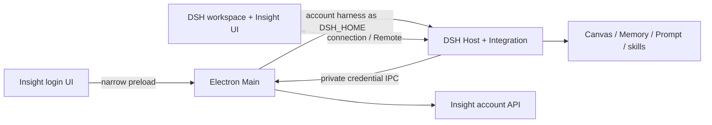

# Insight Desktop 架构

[English](architecture.md) | 中文

## 摘要

Insight Desktop 保留 DSH 运行时和原生工作区布局，同时负责产品标识、认证、账号存储、凭据与工作区品牌。产品选择发生在 Electron 读取产品范围状态之前。成功登录并获得安全账号 Home 后，才能启动业务 Host。官方 Desktop 产品继续使用既有启动和 profile 行为。

## 产品与运行时标识

Insight 应用使用显示名 `因赛AI`、应用 id `com.insight-aigc.desktop` 和已打包 Electron `userData` 名称 `insight-desktop`。开发环境使用 `insight-desktop-dev`。原生窗口、菜单、Dock、托盘、About 和安装器资源使用 Insight 品牌，title bar 策略与工作区布局仍采用 DSH Desktop 实现。

Insight 产品版本与 DSH 运行时版本相互独立。打包要求显式的 Insight `1.x` 语义版本，让工作区包版本保持 DSH 运行时版本，并把运行时记录在 `dshDesktopRuntimeVersion`。Main 在安全产品元数据中同时提供两个版本，便于支持人员区分产品投放与基线运行时变化。

Insight 产品界面仅支持中文。产品选择会强制既有原生 Desktop 消息角色使用中文，并提供中文登录与账号文案；它不增加语言选择器或 Insight 翻译字典。官方产品保留既有语言行为。

## 启动与账号归属

Insight 在创建账号 profile 或启动 Host 前打开隔离的原生登录窗口。Main 进程校验登录输入，使用专用 Electron session partition 发起账号请求，并通过 `safeStorage` 将已打包凭据存储在 `<userData>/insight/auth/<environment>.json`。开发环境不持久化凭据。在准入前关闭登录窗口会直接退出，不启动 Host。

一个 Desktop 进程只归属一个不可变的已认证账号。账号 scope 是对服务环境和稳定用户 id 计算 SHA-256 后取得的前 32 个十六进制字符。其 DSH Home 为 `<userData>/insight/accounts/<scope>/harness`，即 Insight Shell 使用的账号目录。

Home 准备只会为新账号创建 `harness`，否则只选择其中内容而不转换；之后正常 DSH profile、storage 和 Session 写入都使用该 Home。仅有 `harness-native` 而没有历史 `harness` 时会阻止 Host 启动并报告 `pre-release-data`，不创建空后备 Home，需由产品维护人员决定恢复方式。两个目录同时存在时，以 `harness` 为准，`harness-native` 保持不动。

## 进程数据流

登录渲染器只获得 session 状态、短信/密码命令、协议窗口和本地退出所需的窄 preload API。准入后，Desktop Main 使用固定账号 Home 作为 `DSH_HOME` 启动 Host，在 Main 自有认证状态中保存访问令牌，并激活[产品必需的 bundle](baseline-changes.zh.md#baseline-synchronization)。

Host bundle 挂载 `ctx.insightAccount`。可信 Host 消费方通过私有子进程通道，用品牌化请求 id 请求访问令牌。两端都校验精确消息字段、限制并发请求、支持取消与截止时间，并忽略重复或迟到响应。Desktop Main 只回答当前存活 Host 子进程；令牌不会写入日志、保留在 Host 诊断中、通过 Remote 暴露或发送给渲染器。

已认证工作区 preload 只暴露账号摘要、产品/运行时信息、订阅和退出。它要求 Insight 启动参数、顶层 `dsh-app://app` 文档以及 Main 的所属窗口校验。Client bundle 使用既有 DSH 品牌 slot 和侧边栏页脚显示 Insight 标志、显示名、脱敏手机号、头像与账号菜单。菜单设置操作打开共用 DSH 设置面板，Insight 分区显示账号、产品版本、服务环境和平台。

产品将默认模型固定为 `yinsai-gateway/deepseek-flash`，并隐藏模型凭据设置。Main 根据准入认证环境提供 `DSH_INSIGHT_SERVICE_ENVIRONMENT`；必填的 `serviceEnvironment` 配置选择配对网关地址。Host 适配器每次请求通过 `ctx.insightAccount` 获取经 Main 校验的令牌，再由公开 DSH `PiAiAdapter` 执行协议转换和流式输出；账号令牌不进入用户设置或渲染器。

退出和账号过期会在资源拆除前关闭准入。Main 移除渲染器访问，清除 Host URL、cookie 和 injection 状态，隐藏工作区，等待平台视图、文件拖放服务和 Host backend 停止，清除认证与 session 存储，然后重启回登录门。关停失败会打开原生致命恢复，而不会在同一进程中启动另一个账号。

## 源码与发布归属

[packages/insight](../../packages/insight/README.zh.md) 负责私有 Desktop 集成和三个固定业务源码包。Canvas、Memory 和 Prompt 保留其源码标识，并在 Insight profile 中激活。Desktop Main 在解析登录 shell 环境后传入固定的必需 bundle 策略；Plugin Manager 将它与普通 profile 配置合并，不替换用户 registry。组件停用、移除、更新和替换操作执行此策略；内部功能开关仍归各包拥有。

[Integration bundle README](../../packages/insight/desktop-integration/README.zh.md) 负责记录 bundle 本地 Host 条目和运行时包解析维护规则。

每个固定业务包在 `upstream.json` 中记录上游仓库、提交和版本；工作区版本跟随 DSH 根版本。源码改动提交到父仓，`patches/insight` 记录相对固定输入的可回放差异。正常构建不会给已安装文件打补丁。[产品清单](../../scripts/insight-package-policy.ts) 中的精确标识保持私有，并排除于公开 npm 基线。

Insight 技能中心读取已发布目录，并将平台技能安装到当前账号的本地数据中。已提交的安装技能会作为“平台预置”被发现；每个已安装技能说明旁可选的 `ui.json` 提供展示信息。[技能中心包](../../packages/insight/skill-center/README.zh.md)负责安装、更新、移除及账号本地持久化规则。

[Desktop Integration 包](../../packages/insight/desktop-integration/README.zh.md#desktop-updates) 在唯一 DSH updater 之上负责已签名正式版和内测版发现。GitHub 打包构建与 OSS 渠道发布保持为相互独立的操作。

## 相关文档

开发和发布操作见[操作手册](operations.zh.md)，官方接入理由见[基线改动](baseline-changes.zh.md)，服务方法见[生成的账号 API](../subsystems/insight.zh.md)。

## 开发备注

无。
