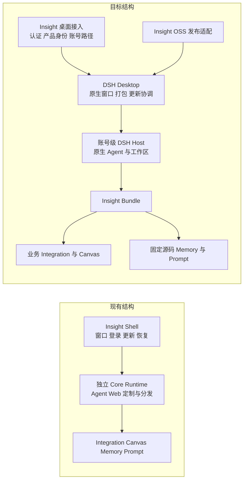
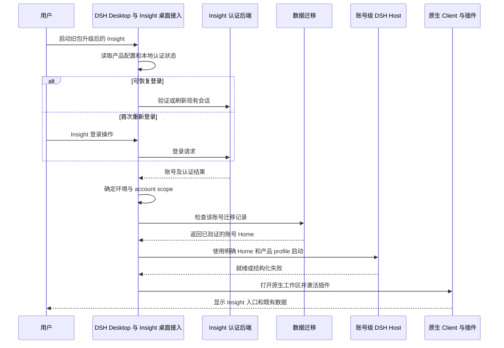
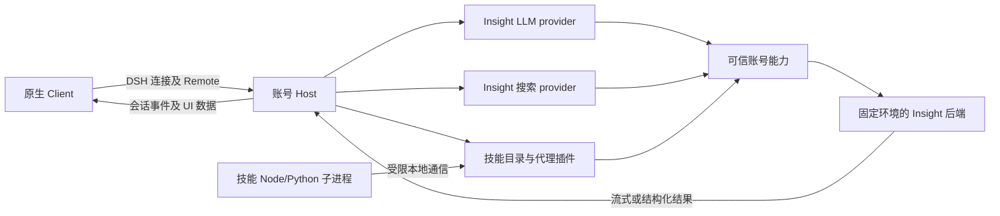
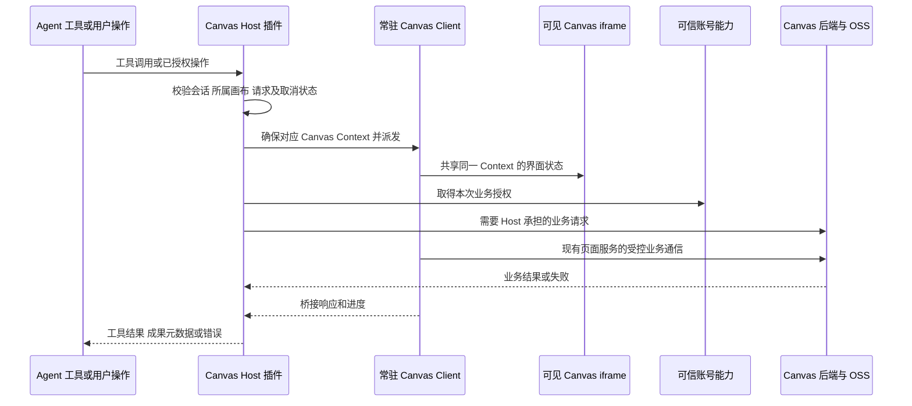
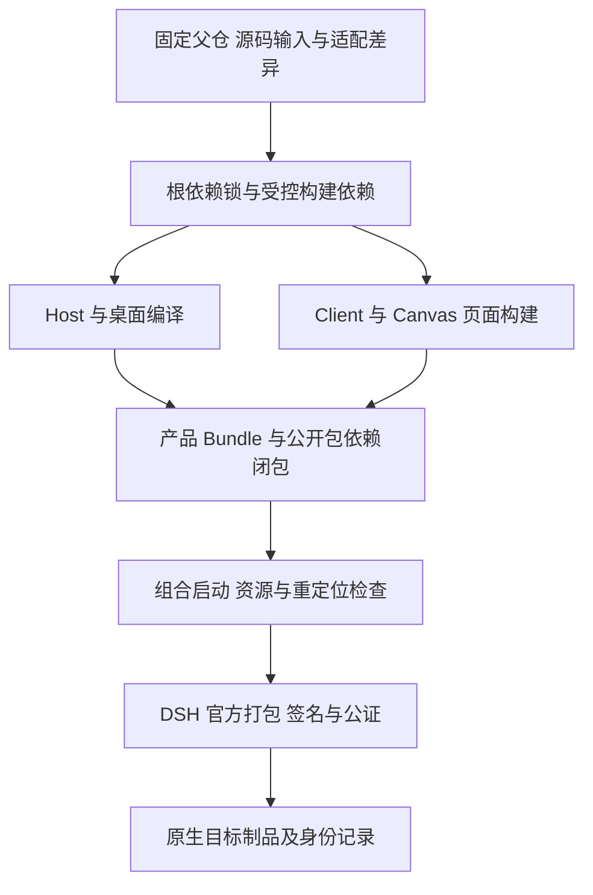
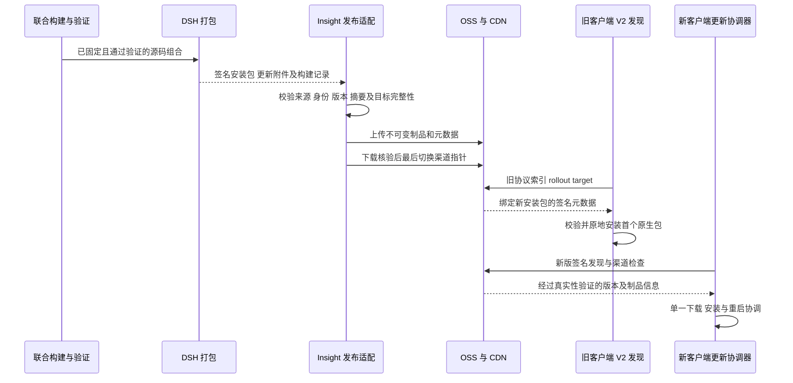

> 冻结历史记录：保留旧 Shell 在记录日期的结论和验收状态，不代表当前实现或线上状态。现行说明见 [Insight 文档入口](../../../README.zh.md)。

# Insight 迁入 DSH 原生 Desktop 执行报告

日期：2026-10-28（Asia/Shanghai）。文档版本：16；收口更新于 2026-11-02。状态：P1–P4 已阶段交付；P5 三平台构建、GitHub Release 和 Candidate 1.0.10 投放完成，可以进入 P6。待验证场景后续反馈为 bug，不视为已通过。本文保留迁移取舍与功能清单，当前制品、源码差异及下一阶段依据以 [P5 交付](2026-10-30-dsh-insight-p5-delivery.md) 和 [P6 交接](2026-11-02-dsh-insight-p6-handoff.md) 为准；P6 清理尚未开始。

## 摘要

目标是在 DSH 的 `insight` 分支中交付 Insight 客户端：保留 Insight 品牌、启动、登录、业务入口和既有能力，工作区、标题栏、基础桌面行为及打包采用 DSH 官方实现。现有客户端必须能够原地升级，保留历史会话、工作区、插件、记忆和配置，允许首次重新登录。正式版和内测版继续使用现有 OSS/CDN；正式版常规检查 Stable，rc 版没有可升级 Stable 时也检查 Candidate；更新窗口五连击确认后可手动检查内测。

实施优先顺序为：直接使用官方能力、通过公开接口组合能力、增加最小宿主接入、最后才考虑独立 `insight-client`。Shell/Core 中的现有实现用于还原需求、数据和失败案例，不作为必须照搬的架构。Canvas 迁入 `packages/insight`；Memory Evolve 和 Prompt Enhance 按用户确认采用固定源码快照加父仓补丁，不使用 submodule。

当前公开插件接口不能完整控制登录前启动、账号级 Host 创建、原生凭证通道和产品更新身份。对应官方改动必须先提交具体文件范围和设计，由用户明确授权。后续实现不得把本报告中的目标接口误认为当前 DSH 已存在的 API。

## 目录

1. [范围和执行约束](#1-范围和执行约束)
2. [基线与证据](#2-基线与证据)
3. [架构变化和取舍](#3-架构变化和取舍)
4. [目标目录与职责](#4-目标目录与职责)
5. [功能迁移清单](#5-功能迁移清单)
6. [启动与账号数据流](#6-启动与账号数据流)
7. [业务与 Canvas 数据流](#7-业务与-canvas-数据流)
8. [持久化数据迁移](#8-持久化数据迁移)
9. [构建和源码依赖](#9-构建和源码依赖)
10. [发布与更新数据流](#10-发布与更新数据流)
11. [官方改动轨迹和基线同步](#11-官方改动轨迹和基线同步)
12. [实施阶段和任务依赖](#12-实施阶段和任务依赖)
13. [风险和失败处理](#13-风险和失败处理)
14. [验收与代码生成规则](#14-验收与代码生成规则)
15. [早期设计分类与证据入口](#15-早期设计分类与证据入口)

## 1 范围和执行约束

### 1.1 已确认的产品要求

- 客户端名称与图标采用现有 Shell 的“因赛AI”及配套资产，保留启动、登录、账号和定制入口，工作区使用 DSH 原生布局。
- 所有既有客户端能力均有迁移去向；默认关闭或实验性的能力不能仅因未启用就被删除。
- 客户端标题栏按 DSH 官方对应窗口类型的策略实现。
- 支持旧客户端原地升级，完整保留用户历史对话、分支、附件及相关资源、工作区、插件和配置；允许首次重新登录，重新登录不清空或隔离掉原账号历史。
- 当前不做 Insight 多语言适配，以现有中文流程验收；不新增其他语言翻译，不删除已有语言资源，也不修改 DSH 官方 locale 能力。
- 使用 DSH 打包流程，迁移 OSS 上传、内测发布、渠道发现和必要升级兼容。
- 内测保留更新窗口图标 3 秒内五连击及风险确认；后续追加 rc 客户端在没有可升级 Stable 时常规检查 Candidate，final 客户端常规检查仍只读 Stable。检查本身不授权下载或安装。
- 持续同步官方 DSH；业务代码集中在 Insight 子包，减少官方源码差异。
- `insight-workflow-op` 属于旧方案，可在 Canvas 功能替代并完成历史读取兼容后退役。
- 对等能力优先参考 DSH 官方 Client，允许在直接修改范围过大时评估 `insight-client`。
- 用户在 P0 确认 Integration、Canvas、Memory、Prompt 均为必需组件；内部可选模块保留开关，其他用户插件仍保留选择。
- Memory/Prompt 使用用户指定上游的固定源码；营销灵感库先保持现状，登记为后续争议点。
- 随包独立 `dsh` CLI 安装/命令入口不属 Insight 产品，无需适配；不据此移除官方 CLI、Agent shell、Memory 外部 CLI、专家技能脚本或随包 Node。
- 尚未完成的原生平台、数据逐项和恢复验证由后续反馈，有问题按 bug 处理，不阻断 P6；保留未验证和历史检查失败事实。

### 1.2 当前授权范围

P1/P2 已确认，P2 代码阶段提交为 `ef5b752aca`；P3 阶段提交为 `ff40a73591`，验证与未通过项见 [P3 验收](2026-10-30-dsh-insight-p3-acceptance.md)。用户已明确进入 P4，并确认复用旧账号 `harness` 作为 DSH_HOME。P4 不导入或转换历史数据、不合并 `harness-native`、不登记未归属会话，也不处理旧定时任务；不因进入 P4 将 P3 未关闭项视为通过。

P4 已完成默认路径适配、聚焦检查和真实旧数据副本的首次登录、重启后历史复核；代码阶段提交为 `675192ea4b`，完整 doc-sync 仍有两项现有文件门禁失败。结果、风险及未验范围见 [P4 交付](2026-10-30-dsh-insight-p4-delivery.md)。P4 不承诺旧 web profile 的全部设置自动成为 desktop profile 有效设置。

P5 已交付最终版本号 1.0.10 的 Candidate，三目标构建和 OSS 发布成功；用户报告 macOS arm64 从 1.0.8 升级成功。Candidate 与 Stable 是渠道，均可使用 final 制品，rc 另用 V3。现有 1.0.10 未包含后续双协议 Candidate reader 源码修复，需随下一次自然版本交付。Stable 仍保持 1.0.9，未授权转 Stable。完整状态见 [P5 交付](2026-10-30-dsh-insight-p5-delivery.md)。按最新范围可以进入 P6；旧验证计划不再构成阶段入口门槛。

用户已确认 P0 并授权 P1：创建 `insight` 分支，接入 Canvas、Memory、Prompt 源码及必要构建配置；阶段结束等待确认，不顺带修改默认启动、登录或更新行为。具体方案与待确认事项见 [P0 设计交付](2026-10-28-dsh-insight-p0-design.md)。分支名按用户要求使用 `insight`，不自动改成其他前缀。

P1 收尾结果见 [交付报告](2026-10-28-dsh-insight-p1-delivery.md)：构建、汇总类型检查、隔离 Loader、三个组件包及源码回放通过；完整 hygiene 19/23、doc-sync 42/43，全仓 lint 未通过。依赖准入和新增 UUID helper 已关闭；用户确认路由、历史断言及剩余固定业务源码 lint 进入 P3；后续明确当前不做 Insight i18n，相关两项检查保留失败记录并列为范围外，不能将本阶段接入成功等同于可发布。

本报告不授权自动接受新协议、真实付费生成、生产发布、删除历史数据或覆盖线上渠道。实现和测试计划应分别说明需要的测试环境、账号、制品和后端操作；不要把构建通过解释为可直接投放。

### 1.3 登录与 API 的实施归属

P2 已完成原生登录和账号 API；统一业务后端接入仍属于 P3。登录 UI 的迁移来源是 Shell 的 `src/renderer/src/LoginView.tsx`，账号生命周期、认证 HTTP 与 IPC 分别位于 `src/main/auth/auth-session-manager.ts`、`auth-api-client.ts`、`auth-ipc.ts`。P2 已将必要能力迁入 `packages/insight/desktop-integration/src/desktop`，通过已批准的官方 Desktop 接入点控制登录前后启动、凭证与账号 Home；验证码/密码登录、刷新、退出等账号 API 同属 P2。用户反馈后又明确前置固定默认模型网关并隐藏模型配置，相关结果见 P2 交付报告。登录必须在业务 Host 启动前可用，不能只依靠 Host 插件实现。

旧业务接入位于 Shell 的 `packages/insight-desktop-integration/src`，包括 `model-gateway.ts`、`model-credential-client.ts`、`web-search.ts` 和技能代理。目标是在 P3 迁入新 Integration 的 Host 面，复用 DSH provider、Remote 和账号能力。Canvas 自有业务接口继续由 Canvas 拥有，凭证和环境由 Integration 提供。P1 已有的插件局部认证检查不等同于完成 Insight 登录或这些云 API 的接入。

### 1.4 取舍原则

每项旧代码先归为产品需求、历史数据兼容、被官方替代的基础实现或无消费者的遗留实现。不明确的业务行为暂停对应取舍并追问，不以代码复杂度推断功能可以删除。替换实现可以减少页面、进程、缓存和状态，但必须保持操作结果、错误反馈、数据及恢复能力。

不建立第二套 Agent loop、通用插件容器、runtime 下载管理器或更新下载器。不为每个后端接口拆包，不创建接受任意 URL 的万能业务代理。不因统一目录而重写 Canvas 业务页面或强制统一其 iframe 内部 React 版本。

## 2 基线与证据

### 2.1 源码快照

下表仅是 2026-10-28 的只读分析基线，不是当前 HEAD。文档收口前 insight 源码为 `a7088fdb63c0d04499fdf4d50ae31d0e73b40b0f`，已发 1.0.10 安装包源为 `95c1477d080ef88330ef961f41042cedba627fd5`；两者差异与运行链接见 P5 交付。

| 仓库 | 分支 | 提交 | 用途 |
| --- | --- | --- | --- |
| deepseek-harness | migrate | `f3803c96974ad4a94195fb97e5c637e9c2a3afe3` | 目标官方实现，包版本 `0.2.2-alpha.2` |
| insight-desktop-shell | main | `d70ba7d25e4c82d34b8931e47895b87ea69aead3` | 产品行为、账号数据、发布协议和安装身份来源 |
| insight-harness-core | master | `90e7d68e5472883e54affe254eebc2bc0a97f7bc` | 最新定制增量和历史兼容来源，runtime 包版本 `0.2.1-rc.2` |
| desktop-canvas-plugin | main | `6a2f8c2fb5ed0a2bb4798ba6c07b48cc88a71e11` | Canvas 迁入来源，包含近期音乐及参考音频变化 |

Shell 的 runtime lock 已指向上述 Core 提交。lock 中历史命名的 release tag 不能代替包版本和 commit 判断；实施时使用完整制品记录。

当前随包 Memory 为 `0.1.0-insight.1`，来自已做 rc.2 适配的制品；Prompt Enhance 为 `0.2.7`；随包 Canvas 为冻结的 `0.3.0-alpha.32`。Canvas 当前源码 manifest 显示 `alpha.31`，同时包含后续变化，不能按版本字符串判断新旧。随包 Canvas 归档还包含当时工作区变化，重建其记录的基础提交不保证重现归档字节。

### 2.2 证据范围

本机已完成测试账号登录，读取了工作区、历史会话、账户菜单和插件列表，确认 Canvas、Integration、Memory 和 Prompt 插件已启用，旧 Workflow 插件停用。部分嵌入页面点击受本机 UI 自动化限制，未逐页完成操作验收。登录凭证不写入报告或测试 fixture。

已做源码和本地发布档案分析，并对部分归档摘要和签名做只读校验。该证据不证明 CDN 当前内容、安装包二进制、三平台原地升级或付费业务链已通过。本报告没有执行新的真实生成、上传、构建或安装更新。

实施开始时重新读取四个 HEAD、工作区状态、实际在投版本和制品摘要；若发生变化，先更新本表及受影响结论，不能静默使用另一基线。

## 3 架构变化和取舍

### 3.1 从现有结构迁移到目标结构



原 Shell 和 Core 逐步退出正式构建链。迁移期间作为只读来源和旧客户端发布兼容来源保留，不把旧目录作为新客户端运行时依赖。

| 现有职责 | 目标承担者 | 退役条件 |
| --- | --- | --- |
| Shell 窗口、标题栏、平台菜单、主题 | DSH Desktop/Client | 对应操作和平台验收通过 |
| Shell 登录和账号生命周期 | Insight 桌面接入 | 认证、过期、退出、多账号验证通过 |
| Core Agent/Web 通用实现 | 官方 DSH | 业务及会话兼容验证通过 |
| Core 定制技能交互和目录 | 官方能力加 Integration | 显式选择、失败保留、目录刷新等行为覆盖 |
| Core runtime 压缩包及部署修复链 | DSH 打包 | 原生制品闭包、搬迁、Node 环境验证通过 |
| Shell 更新执行器 | DSH 单一更新协调器 | 旧版桥接及新版再次更新通过 |
| OSS 发布、签名元数据、内测策略 | Insight 发布适配 | 同一产物的完整校验和投放验证通过 |
| 旧 Workflow 执行能力 | Canvas | 功能替代及历史呈现/导出通过 |

### 3.2 官方 Client 与 insight-client 的选择

首选官方工作区和 UI 包，使用内层插槽增加品牌、账号与业务入口。不要为增加一个入口替换整个侧栏或根布局，否则原插槽及消费者可能一起消失。

只有在差异清单证明长期需要替换多个核心界面、现有组合机制无法保持产品行为、且独立组装能减少持续维护时，才提交 `insight-client` 方案。该方案仍复用官方启动内核、会话、编辑器、连接、终端和插件机制；不复制整套 Client。单纯的宿主认证、产品构建或更新差异不是分叉工作区的理由。

### 3.3 标题栏策略

工作区和 Welcome/登录窗口分别沿用官方同类窗口策略。当前 macOS 工作区使用 `hiddenInset`，Windows 主窗口使用隐藏标题栏和原生按钮 overlay；Welcome 的尺寸、交通灯、材质和按钮策略与工作区不同。不得把一种窗口配置强行用于全部窗口。

官方继续负责拖拽区、窗口全屏状态、侧栏折叠、主题和系统按钮协调。Insight 提供品牌、标题和内容，旧 Shell 标题栏补丁在替代验证后删除。窗口样式复用不等于扩大网页权限：页面 fullscreen、clipboard、microphone、camera 和 pointerLock 按请求者所有权、可信来源和 frame 范围核对，保留或收紧原有允许范围，其他权限默认拒绝。

## 4 目标目录与职责

以下为拟议目录；实施时依据现有包门禁确定最小 exports、构建入口和包名，不视为现成 API。

```text
deepseek-harness/
├─ apps/desktop/                     官方桌面入口，少量已批准接入
├─ apps/desktop-host/                官方 Host 载体，按需接入账号服务
├─ packages/insight/
│  ├─ desktop-integration/
│  │  ├─ src/desktop/                登录、账号、原生宿主接入
│  │  ├─ src/host/                   模型、搜索、技能、账号服务消费者
│  │  ├─ src/client/                 品牌、账号菜单、技能和业务入口
│  │  └─ src/shared/                 跨进程 DTO、环境及错误定义
│  ├─ canvas/                        自有 Canvas 源码及业务页面
│  ├─ bundle/                        产品组合及默认配置（后续阶段）
│  ├─ memory-evolve/                 固定上游源码快照及适配
│  └─ prompt-enhance/                固定上游源码快照及适配
├─ bundled-skills/                   保留来源仓库的整目录同步结构
├─ patches/insight/                  相对固定上游输入的可复现差异
├─ scripts/insight-release/           OSS、发布元数据和旧协议适配
└─ docs/…                            实施后按归属维护文档
```

| 单元 | 负责 | 不负责 |
| --- | --- | --- |
| desktop-integration 的 Desktop 面 | 登录前流程、凭证持久化、账号 Home 选择、向 Host 提供账号能力 | Agent loop、重复下载器、复制窗口系统 |
| desktop-integration 的 Host 面 | DSH 服务提供者、技能目录/代理、业务环境接入 | 选择任意账号目录、通过 HTTP/renderer 输出凭证 |
| desktop-integration 的 Client 面 | 安全账号信息、品牌及定制入口 | 凭证存储、后端密钥、原生进程管理 |
| Canvas | 画布工具、桥接、业务页面、成果和资源 | 自建登录、自己决定产品环境或更新源 |
| Bundle | 组合官方和 Insight 能力、保证四个必需组件、声明配置 | 覆盖其他用户插件选择或丢弃组件业务数据 |
| 发布适配 | 选择并校验官方构建物，生成元数据，上传 OSS | 再造独立 runtime 或下载/安装执行器 |

Desktop、Host、Client 分开编译；renderer 不可通过共享 barrel 引入 Electron、凭证或 Node 模块。普通库函数保留为函数，不为复用登录 HTTP 客户端而增加一个进程或插件容器。Node 应用仍通过受支持的 `dsh` profile 启动，不新增绕过 launcher 的应用 bin。

新 Insight 包的命名、测试归属和产品包分类必须显式接入 DSH 门禁。保留已有插件持久化标识；若包名必须调整，先提供标识映射和迁移，不能靠重命名让旧配置失联。

## 5 功能迁移清单

下表保留功能编号和迁移去向，不是尚未实现清单。实际证据按 P1–P5 阶段报告读取；后续范围修订以本节及 P6 交接为准，不因阶段收口把未验证写成通过。

| 编号 | 必须保留的功能 | 首选实现及验收重点 |
| --- | --- | --- |
| F01 | 品牌、启动页、进度、恢复登录 | Insight 内容接入官方桌面生命周期；失败有可恢复状态 |
| F02 | 短信/密码登录、验证码、协议、退出和过期 | 认证模块；首次重登可用，不要求官方账号二次登录 |
| F03 | 环境和账号隔离 | 既有 account scope；旧账号进程、请求和回调不能进入新账号 |
| F04 | 企业模型、流式响应、图片和历史模型标识 | DSH LLM provider；不要求用户另填厂商 Key |
| F05 | 企业搜索和技能业务请求 | DSH provider/Host 插件；保留流式、取消和错误语义 |
| F06 | 专家技能发现、平台/账号/共享目录和多选 | 官方加载加 Integration；草稿显式引用，成功清理、失败保留，重复/无效项有反馈 |
| F07 | 随包专家技能和辅助脚本接入 | 保留根 bundled-skills 结构、整目录同步和资源复制；不验证或改写技能内容、脚本及业务正确性 |
| F08 | 会话、分支、轨迹、工具卡、附件及反馈 | 官方 Client；旧工具历史结果可读、可导出 |
| F09 | 工作区、搜索、目录选择、系统打开 | 官方能力；工作区本地路径不变 |
| F10 | 终端、权限模式、子 Agent、团队、自动化及可选功能 | 官方原生组合；保留现有配置及启停选择 |
| F11 | 插件查看、配置、启停和目录/tgz 导入 | 官方管理及恢复；来源、用户替换和显式卸载策略清晰 |
| F12 | Memory Evolve 全部现有模块 | 源码适配；分层记忆、技能、待办、书签、CLI 调度、提示词、通知、同步、评审及素材画板按原开关可用 |
| F13 | Prompt Enhance | 官方编辑器接口；预览、回填、复制、撤销及原稿保留 |
| F14 | Canvas 工具及手工 UI | 完整工具、生成/处理、引用、上传、媒体、音乐/参考音频、取消及重登验收 |
| F15 | 账号菜单、使用手册、设置和版本信息 | 官方插槽/设置；Insight 账号入口替代不适用的官方账号入口 |
| F16 | 菜单、快捷键、右键、拖拽、主题、缩放及窗口行为 | 官方实现；按 macOS/Windows 验证，并验证页面权限的 owner/origin/frame 允许和拒绝矩阵 |
| F17 | 日志、重启、安全模式和故障恢复 | 复用官方恢复并接入必要菜单；用户已确认 Windows GPU 自动降级和 macOS LaunchAgent 常驻审计修复不迁入 |
| F18 | 会话导出 | 复用 DSH 当前会话导出；P4 最终简化范围排除任意旧文件只读导出，不再恢复独立历史文件工具 |
| F19 | 稳定/测试更新、提示、重试、跳过及强制策略 | 单一协调器加 Insight 策略；未登录也可更新 |
| F20 | 原地升级和数据连续性 | 旧安装身份、真实旧版本数据及三平台验证 |
| F21 | 旧 Workflow 退役 | Canvas 覆盖未来操作；旧会话呈现和导出先通过，必要时保留只读 presenter |

Memory 的本地素材画板与 Canvas 的业务生成画布不因名字相近而合并；需要证明数据和操作均被覆盖后才可另行取舍。可选模块迁移时保留默认和用户状态，不自动全部开启。

### 5.1 专家技能专项

本次只迁移专家技能的选择入口、目录/元数据、DSH 加载及随包资源接入。用户明确内置技能正确性不在迁移范围，不检查或改写正文、脚本、参数、依赖及业务输出；`bundled-skills` 保持根目录和既有同步形态，不能迁入业务包或拆分结构。P0 按当前源码冻结 15 项随包技能；清单、目录名与实际调用名差异、历史依赖记录和当前接入范围以 [P0 专家技能设计](2026-10-28-dsh-insight-p0-design.md#3-专家技能专项冻结)为准，逐文件摘要见 [技能资产清单](2026-10-28-dsh-insight-p0-skill-inventory.json)。该资产盘点不是已安装环境中 15 项均可调用或真实业务验收通过的声明。

P3 已按后续授权恢复旧式 `toggleSkill` 输入动作，由 Insight Picker 负责技能库存和多选，官方输入接口负责局部编辑；不通过整段 `setDraft` 重写草稿。当前实现归属及检查见 [Integration README](../../../../../packages/insight/desktop-integration/README.zh.md) 和 [基线台账](../../../baseline-changes.zh.md)。[早期设计](2026-10-29-dsh-insight-toggle-skill-design.md) 保留审批背景，不再表示功能尚未接入。

## 6 启动与账号数据流

### 6.1 正常启动



登录前不启动正常业务 Host；恢复登录失败返回 Insight 登录流程。不能因为复用了官方 Desktop 就要求用户再走一次官方 DeepSeek 登录或 API Key Welcome。官方 Host 协议和 `dsh` 启动方式保留，产品启动门负责决定何时创建 Host。

主进程在登录确定后计算账号路径，并作为 Host 创建参数传入。运行中的 Host 不靠修改全局环境变量切换账号。用户状态是有序转换：恢复/登录、数据准备、启动、工作区、退出/过期；异步回调必须核对当前账号及本次启动标识，丢弃旧启动结果。

### 6.2 退出、过期和切换

退出或账号变更时先禁止旧 Host 接收新操作，通知现有 UI，取消旧请求，关闭旧 Host 和业务资源，再撤销或清理本地认证状态。最终由 Insight 登录页承接；不得让旧 iframe、SSE、CLI 子进程或迟到响应继续操作新账号。

凭证由一个账号管理者负责刷新和失效处理。模型、搜索和 Canvas 不各自维护独立 refresh 状态；并发刷新合并，过期结果统一触发账号流程。远程注销失败须有明确本地处理和反馈，不把网络失败解释为仍允许旧操作。

### 6.3 拟议账号服务语义

实施时可以沿现有 DSH 服务风格命名；以下是必须满足的行为，不是当前已存在的符号。

| 消费者 | 可以获得 | 不可以获得 |
| --- | --- | --- |
| Client/登录 UI | 昵称、头像、安全账号标识、登录状态、允许的认证操作 | refresh token、完整 credential record、任意主进程调用 |
| 受信任 Host 业务插件 | 当前账号所需短期授权，或由可信端代发的业务请求 | 选择其他账号凭证、改变生产/测试地址 |
| Canvas iframe | 绑定本实例和会话的桥接能力、必要业务结果 | 登录 bearer、主进程 IPC、可任意改写的来源身份 |
| 技能子进程 | 范围受限的本地调用能力 | 直接读取持久化账号凭证 |

私有 IPC 的保证是凭证不经 renderer 或公开 HTTP 分发，不是隔离同进程恶意 Host 插件。Host 插件保留 DSH 的受信任 Node 扩展模型；不声称 `remoteAccess` 是账号登录或插件沙箱。

## 7 业务与 Canvas 数据流

### 7.1 模型、搜索和技能



模型、搜索和技能目录优先实现为 DSH 服务提供者。面向界面的业务调用使用当前 DSH Remote 机制；现有 HTTP 路由只有在浏览器资源、流式协议或独立进程确实需要时保留。插件化不意味着删除跨进程通信，也不意味着把全部接口换成工具。

环境、后端地址和能力范围由可信产品配置决定，在加载时校验；不允许页面、模型工具参数或任意远程响应改写。Integration 不再跨目录导入旧 Shell 源文件。模型历史 wire ID、能力和错误语义单独核对，不只验证新模型列表。

独立技能进程保留必要代理，继续处理请求范围、流式背压、取消、超时、退出清理和脱敏错误。会产生费用或副作用的业务操作不因网络异常自动重发；保留后端已有的幂等或状态查询语义。

### 7.2 Canvas



图示保留现有 Host 与页面业务服务的职责，不能据此把全部 Canvas 网络请求重写到 Host，或让 iframe 获得登录 bearer。实际迁移按调用点核对，并复用 DSH 已提供的附件、存储、会话、工具、任务和 UI 能力。

Canvas 当前只接受 HTTP/HTTPS 形式的桥接来源，原生 Desktop 页面使用 `dsh-app://app`。适配必须由可信桌面传输和 DSH connection 建立页面来源、Host 连接、client 实例及会话的绑定；桥接 key 继续检查所有权和生命周期。不得仅信任页面自报的 `x-canvas-bridge-origin`，不得通过允许任意 Origin 或关闭 `webSecurity` 修复。

验收分开覆盖动态模块、SSE、iframe、媒体、文件选择、资源 URL、OSS/CORS、全屏及导航。登出、切换会话或插件卸载时撤销桥接、订阅和请求。任务识别必须同时覆盖 Agent 工具和用户在页面发起的运行，供更新和退出判断使用。

工具验收覆盖 `canvas_create`、`canvas_get`、`canvas_node_edit`、`canvas_edges`、`canvas_models`、`canvas_assets`、`canvas_asset_import`、`canvas_run`、`canvas_open`、`canvas_list`、`canvas_capabilities`、`canvas_layout` 和 `canvas_process`；实施前以当前工具声明核对实际名称与参数。音乐、参考音频及所选模型限制单独设用例。

## 8 持久化数据迁移

历史对话保留是发布硬门槛。P4 让 DSH 直接使用 Shell 账号已有的 `harness` 目录，不复制、转换或合并已有内容；启动后的正常 DSH profile、storage 和 Session 写入仍发生在该 Home。首次重新登录必须回到原后端 user ID 对应的历史账号，不能用空 Home 覆盖、隐藏或代替原历史数据。

必须保留对话标识、标题、时间、用户/助手消息、轮次、分支关系、工具轨迹与结果、附件和成果引用、工作区关联。支持的历史对话在 DSH 原生列表可见、可打开、可继续对话；继续时追加新记录，不重放历史付费操作或工具副作用。遇到暂不支持的旧记录，保留原件并明确报告，提供只读查看或导出，不静默丢弃或伪造迁移成功。

P4/P5 验收应对照来源与目标清单检查对话/分支数量和标识、关键消息内容、附件/成果可访问性，并覆盖重登、重启及启动失败后的重试；历史对话丢失、账号错配或界面不可访问均阻止发布。历史旧 Workflow 执行器可退役，但对应历史对话与结果仍按此规则保留。

### 8.1 数据所有权和目录

继续使用历史 `userData` 与既有 account scope 派生规则。scope 来自可信环境和后端 user ID，不从手机号、显示名或页面传入目录计算。旧账号根路径保持可定位，新 DSH 不落入默认公共 Home。

用户已确认继续使用旧账号目录中的 `harness` 作为 DSH_HOME，不迁到第二个长期 Home；项目 cwd 仍由各工作区持有。P4 不创建 profile 暂存、接管记录或定向备份。新客户端使用原生 desktop profile，web profile 和原数据保留，不由新客户端启动旧组合。

```text
<userData>/insight/accounts/<scope>/
├─ harness/                          canonical DSH_HOME，直接复用
└─ harness-native/                   若有，仅保留，不自动合并
```

不 rename `harness`，不复制用户项目文件树，也不以全量数据复制作为前提。Session、工作区、插件、配置、附件和业务数据继续由原有拥有者管理。若只有 `harness-native`，启动以 `pre-release-data` 停止并要求联系产品维护人员；不创建空 Home，也不建议用户自行重命名、合并或删除目录。两个目录同时存在时 `harness` 为准，`harness-native` 保持不动。

| 数据 | 迁移要求 |
| --- | --- |
| Session 日志、分支、索引、附件及成果 | 保留原日志世代和资源；重建可重建索引，验证引用有效 |
| 工作区及最近使用记录 | 保留标识和本地路径，不复制真实项目目录 |
| settings、storage、root/profile patch | 原位保留；旧 web profile 不等于新 desktop profile，具体设置是否生效按拥有者验证，不做全文路径替换 |
| 插件安装来源、归档和配置 | 原位保留来源记录；新 desktop profile 使用已确认的四组件组合，不执行旧 web 依赖安装目录 |
| 插件启用、停用、替换和显式卸载 | 四组件执行产品必需规则；第三方配置不删除，其在新 profile 的生效情况单独核对 |
| memories、todos、评审、素材板和插件状态 | 留在原 Home，由实际拥有者读取，不当缓存删除，不另建复制管线 |
| 账号技能 | 保留内容、目录和启停语义 |
| `~/.agents/skills` | 设备共享目录保持原位，不复制为多个互相漂移的账号副本 |
| 更新渠道及必要发布状态 | 迁移测试版 opt-in 和仍适用的状态；旧下载缓存不是业务数据 |
| 登录凭证 | 允许重新登录，不把明文凭证复制进配置或迁移记录 |

### 8.2 P4 验收

验收确认开发和打包 userData 位置、同账号登录后的 `harness` 选择、历史会话可见性，以及 `harness-native` 的保护行为。仅有 `harness-native` 时显示 `pre-release-data` 并联系产品维护人员；不得自行重命名、合并或删除目录。P4 不提供旧二进制回滚承诺。

### 8.3 历史格式和插件策略

已发布 Session 世代不可覆盖或修改。历史格式由 DSH 当前公开读取器处理；P4 不新增格式转换器，不恢复或补跑历史任务。

原地升级通常已替换旧 Shell 二进制，保留旧数据不代表旧壳仍可启动；只有单独验证过安装器或二进制回滚机制时才提供回旧壳选项。新 runtime 开始正常写入后，不承诺旧 runtime 能读取新数据；恢复以新版本前向修复为主，不承诺无损降级。P4 不建立 profile 发布 marker、暂存目录或恢复日志。

不照搬现有托管插件初始化：当前 Shell 会重装部分被删除的默认插件并覆盖部分自定义来源。目标策略应保留用户选择；仅确为产品必需的依赖可以要求修复，并显示原因，不静默覆盖。旧 Workflow 执行器退役不删除同名工作区、历史会话或结果。

P0 中用户已选择 Integration、Canvas、Memory、Prompt 均为必需组件。迁移恢复这四项整体缺失或停用状态，保留内部可选模块开关、配置、数据和旧来源记录；其他第三方插件保留用户选择。具体组件规则见 [P0 管理规则](2026-10-28-dsh-insight-p0-design.md#21-必需组件的具体语义)。不承诺任意旧自定义来源均兼容；未知或损坏来源需要明确诊断/修复，不静默销毁用户内容，也不每次启动重装全部依赖。

## 9 构建和源码依赖

### 9.1 Canvas 迁入

将已选定 Canvas 提交及其必要资源迁入 `packages/insight/canvas`，保留原仓库来源和历史定位方式。迁移提交与功能适配提交分开，便于检查文件丢失；不在迁入时顺便升级整个业务前端、格式化 legacy 或重写状态管理。

接入 DSH 根安装、依赖锁和构建顺序，移除对旧 Shell/build 的验证依赖。插件 Host/Client 使用当前 workspace 的公开 DSH API；不从旧 Core 内部源码深导入。内嵌页面可保留自身依赖和独立构建，但安装、锁文件和输出位置必须有一个明确的产品构建入口。

Canvas 插件包标识和客户端 module ID 与现有配置兼容。随包归档与当前源码并非可直接互换：阶段 0 先固定目标源码和版本，再以功能与历史数据用例证明替代，不声称重现旧归档字节。

### 9.2 Memory 和 Prompt 固定源码快照

用户已指定 Memory 上游 `csyangwen/dsh-memory-evolve` 和 Prompt 上游 `rongxingda/dsh-prompt-enhance`，并确认采用固定源码快照加父仓补丁，不使用 submodule。适配后的源码和 manifest 一起提交到父仓，正常依赖安装直接读取正确声明，不能先解析旧依赖再在构建副本补救。Memory 必须承接 `0.1.0-insight.1` 的有效适配，Prompt 也要承接旧 Shell 的附件、配置表单和主题适配，不自动跟踪最新分支。

父仓记录上游 commit、输入摘要、保留文件和适配差异，源码参与联合构建；运行时加载构建产物，不直接执行 TypeScript 源文件。正常构建不重新打补丁或修改已提交源码，上游同步在隔离目录重放验证后提交新快照和差异。正式包不包含 `.git`、开发者绝对路径、旧 node_modules 或来源仓库凭据。

| 约束 | 实现要求 |
| --- | --- |
| DSH 依赖 | 绑定目标 workspace，避免旧精确版本安装第二套 SDK；不通过全局强制 override 掩盖 API 不兼容 |
| Client 共享模块 | 按官方模块系统处理 React/Cordis 等 externals，保持同页共享实例 |
| 编译面 | 接入 Host/Client 类型和构建顺序，资源与辅助进程文件显式打包 |
| 测试 | 保留子仓必要测试，新增产品组合验证；明确外部源码的检查归属，不静默绕过 DSH 门禁 |
| 版本记录 | 同时记录父仓 commit、上游 commit、源码/补丁摘要、插件 manifest 版本及产物摘要 |
| 独立自更新 | 建议随包版本由客户端发布管理；不得运行时 git pull 破坏已验证组合 |

如果上游结构无法直接纳入当前 workspace，应先识别源文件和构建产物，调整复制/编译规则，不复制旧构建目录伪装完整源码构建。包名、peer 范围和 API 调整进入父仓源码及其可复现差异；不手工维护第二套独立实现，不创建新 fork。固定提交及构建差异见 [P0 源码方案](2026-10-28-dsh-insight-p0-design.md#22-源码来源与适配策略)。

### 9.3 联合构建数据流



沿用 DSH runtime 装配、平台签名、公证和制品验证。Core 最近修复的 vendor 完整性、可搬迁、部署依赖重建及 Node 使用问题转为制品验收案例，不把独立 Core 发布体系一起搬来。

## 10 发布与更新数据流

### 10.1 产品身份与版本

名称与图标是明确的迁移项：产品名沿用 Shell 的 `因赛AI`，图标复用 `build/icon.icns`、`build/icon.ico` 和 `build/app-icon.png`。P2 在 DSH 的产品配置与资源接入点完成桌面应用、Dock/任务栏、窗口、应用菜单和关于页等品牌呈现，P5 核对安装器、快捷方式及更新后表现。开发版保留原有区分名称的策略，工作区与 Welcome 标题栏仍采用 DSH 各自的官方窗口策略。

原地升级要求保持 `com.insight-aigc.desktop`、既有产品安装身份和历史 `userData` 位置。macOS 还核对 Bundle/Helper ID、Team/Developer ID、签名和安装位置；Windows 核对 Publisher、NSIS/uninstall identity、安装范围、自定义目录及 updater cache。不能只改 appId 就判定原地升级成立。

产品、runtime 和数据版本独立记录：

| 字段语义 | 规则 |
| --- | --- |
| Insight 产品版本 | 对齐 Shell 基线 `1.0.9`；首个新内测包为 `1.0.10-rc.1`，正式版使用正式 SemVer；投放前核对实际渠道版本，不覆盖已有不同字节 |
| DSH runtime | 精确版本与 commit；不把整个 DSH 仓库改成 Insight 版本 |
| Host lifecycle 协议 | 单独记录，当前目标基线为 generation 4；不能用它代替业务数据格式 |
| 插件组合 | Canvas、Memory、Prompt、Integration 的来源和摘要 |
| 应用数据兼容声明 | 新版本可读和会写的范围，依据实际迁移验证，不从产品版本推断 |
| Session/存储格式 | 按各存储拥有者定义，保留独立版本与迁移 |
| 发布环境及渠道 | 后端认证环境、OSS 部署环境、用户 stable/candidate 选择相互独立 |

当前 DSH release 与 core package 校验仍存在产品版本和 runtime 版本相同的假设。该假设必须在首个原生 Insight 包前调整，并覆盖解析、打包、运行校验和更新显示的所有消费者，不能只改安装包 metadata。

### 10.2 发布生产链



构建 workflow 以 DSH 为主，完成签名、公证和产物验证，将安装包、更新附件及来源/摘要清单保存到 GitHub Release；发布 workflow 参考 Shell，只读取这些文件并投放现有 OSS/CDN，不重新构建或签名安装包。先上传不可变对象并验证公开下载，再发布目标元数据，最后更新渠道指针。客户端不能观察到指向缺失对象的有效发布。旧协议和新协议使用不同命名空间。相同版本切换发布归属时复用原字节；rc 转正式是版本变化，必须构建正式版本，不能把 rc 制品改名当正式版。

当前由新仓唯一发布，旧 Shell 原仓和 fork 的发布入口已停用，构建流程保留；网关已放行新仓 OIDC 身份。发布器校验构建来源、提交和摘要，不把任意下载文件重新签名当可信制品。OSS/CDN 沿用现有链路；指针采用单发布者写前核对、替换和回读，不承诺原子 CAS。

### 10.3 新客户端更新职责

DSH 负责调度、下载、进度、安装及重启协调，Insight 负责发布来源、签名发现、业务版本与渠道策略。首选在现有协调器/依赖支持的来源扩展处接入，不复制整个 Shell UpdateManager，不同时运行两个 updater 或轮询循环。

新发现流程必须验证元数据真实性，绑定版本、平台、架构、安装包摘要和操作系统签名。只校验一个签名 JSON、随后信任可独立篡改的 feed 不足以满足要求；交给下载器的信息必须与已验证目标一致。具体 adapter/provider 接法在阶段 0 确认，不能未经验证直接更换现有协议。

| 用户动作或状态 | 要求 |
| --- | --- |
| 默认稳定渠道 | 自动检查稳定更新，有更新再提示 |
| 手动检查内测 | 更新窗口图标 3 秒内五连击，风险确认后检查 Candidate；final 客户端后台不轮询内测 |
| rc 版常规检查 | 先检查可升级 Stable；没有时检查 Candidate；不自动下载或安装 |
| 检出更新 | 显示版本与说明，不自动授权下载或安装 |
| 取消内测风险确认 | 不发起内测检查，不自动降级已装版本 |
| candidate 同版本转 stable | 若制品相同则更新发布归属，不重复安装相同字节 |
| 下载失败 | 可重试并显示原因；不能把失败目标当准备完成 |
| 已下载目标与新发现不同 | 确认绑定具体版本，拒绝过期安装意图 |
| 未登录或业务 Host 未启动 | 仍能检查、下载并执行必要更新，不要求先登录 |
| 强制更新 | 迁移既有策略和失败恢复，不沿用不适用的官方账号/策略地址 |

适用且真实性已验证的 required stable 策略优先于 optional candidate。策略约束和候选版本选择由同一个目标解析步骤完成，发现层与协调器不得各自选择不同版本；已安装版本已满足最低要求时不为应用旧 stable 目标而降级。其他强制策略保持现有产品语义并在阶段 0 明确冲突处理。

无 Host 安装仅在生命周期记录证明本次从未启动 Host，或已经完成 clean stop 时成立。Host 对象不存在不代表没有进程：starting、unknown、unclean 或残留子进程状态必须先按官方进程所有权机制核对和清理，无法证明安全停机时阻止安装并报告原因；不得仅凭 PID 杀死无关进程。

### 10.4 安装前任务与恢复

安装授权后，按账号锁定新任务入口，检查 DSH Agent、Canvas 工具、手工画布任务、Memory 外部 CLI 等在途工作；按实际可取消/可等待能力提示并处理。不可取消的远程任务保留其身份和可恢复信息，不能宣称退出即取消后端任务。

进入安装前完成拥有进程的停机，记录更新阶段。用户取消、检查失败、安装器未接管或明确安装失败时，解除任务锁；若 Host 已停止且安装未接管，恢复当前账号 Host。安装器结果未知时先依据 journal 和实际安装版本核对，不无条件重试或误报成功。

Windows 当前卸载清理会处理 Electron userData。Insight 账号数据位于自定义 userData 下，需要单独检查正常卸载、跨目录替换及升级路径，保证迁移和更新不会误删旧/新账号 Home。不得依赖仅保护公共 DSH_HOME 的默认规则。

## 11 官方改动轨迹和基线同步

### 11.1 官方改动职责索引

下表保留最初 U01–U10 的职责分类，不是新增修改授权。已批准并实现的精确范围、保留理由和删除条件以 [官方基线台账](../../../baseline-changes.zh.md) 为准；新增官方改动仍需单独授权，不能把候选位置当修改白名单。

| 编号 | 目的 | 可能涉及的位置 | 完成标准 |
| --- | --- | --- | --- |
| U01 | 登录前启动和产品 Welcome | `apps/desktop/src/main.ts`、Welcome 创建及操作接口 | Insight 登录后才启动账号业务 Host，官方产品流程仍成立 |
| U02 | 账号 Home、profile 和 Host 重建 | paths、project-manager、Host 创建/生命周期 | 明确创建参数、账号隔离和退出清理 |
| U03 | 受控 Desktop—Host 账号能力 | Host 协议、主进程处理和必要 preload | renderer 无凭证读取通道，过期统一处理 |
| U04 | 产品身份与产品/runtime 版本分离 | release、core-package-set、build version、builder 配置 | 产品 `1.x`、runtime `0.2.x` 可独立校验及展示 |
| U05 | Insight 组合和资源进入安装包 | 包选择、前端产物选择、构建引用和依赖清单 | 不依赖旧 Shell/Core 目录，干净构建完整 |
| U06 | 来源、渠道和真实性校验 | update source/channel、coordinator 接入、发布工具 | 一个 updater，OSS 可用，旧版桥接成立 |
| U07 | 无 Host 更新和安装失败恢复 | 安装前停机及更新生命周期 | 区分从未启动、clean stopped 与未知/残留状态；登录前可更新，取消/失败可恢复 |
| U08 | 现有 UI 无法覆盖的定制入口 | 对应 Client 插槽拥有者 | 通用接口、业务内容在 Insight 包；能用现有插槽则不改 |
| U09 | 安装身份及数据保护 | 平台签名、NSIS、卸载清理及构建配置 | 三平台升级身份一致，数据不被清理 |
| U10 | 页面权限与来源策略 | Electron permission check/request、嵌入页面归属和权限处理 | 按 owner/origin/frame 限定权限，默认拒绝；不因复用原生窗口扩大访问 |

类型配置、workspace、构建图、Remote 导出及门禁的必要注册也属于官方文件变化，不能因不是 UI 代码而漏记。官方已有 Client 组件行为尽量不改；新增接口必须有明确消费者，不先建设无需求的通用扩展框架。

### 11.2 改动记录格式

已建立上述官方基线台账，后续在同一所有者文档维护。每项至少包含：编号、产品要求、原生接口不足、文件范围、实现 commit、上游基线、验证证据、当前保留理由和可删除条件。Git diff 是准确修改记录，不另维护与源码重复的完整 patch 文件。

每次同步上游逐项更新台账：上游已覆盖则删除本地实现及其专属文档/测试；仍需保留则重新验证。不要把已解决冲突机械记为通过，也不要只凭文件没有冲突认定功能兼容。

### 11.3 同步策略

在同一仓库保留可定位的上游基线和 `insight` 产品分支。采用独立、职责清楚的提交组织业务包、官方接入和发布适配；阶段 0 确认共享分支使用 merge-forward 还是受控 rebase，不擅自重写他人历史。

每次同步读取官方 API、数据格式、Host 协议、Client 模块和构建变化，按受影响项执行针对性检查。外部源码快照更新也必须固定新输入并走同样验证，重新核对适配差异。Core/Shell 不再同时合并同一上游形成两套活动基线；迁移完成后退出新产品构建。

## 12 实施阶段和任务依赖

每个阶段交付具体可审阅产物。阶段完成不自动授权后续发布；实际命令和测试名称在实施时根据当前仓库确定，以下不是本轮已执行记录。

| 阶段 | 输入和依赖 | 任务与交付物 | 退出条件 |
| --- | --- | --- | --- |
| P0 设计和范围冻结 | 四仓基线、已知产品身份、本文 | 冻结 F01–F21；确定插件提交和管理规则；提交 U01–U10 文件候选、协议和数据布局；评估官方 Client 差异 | 用户确认设计及 P1 范围；实物签名/安装身份作为 P2/P5 前置，所有高风险项有验证归属 |
| P1 源码和构建接入 | P0 批准的目录/依赖方案 | 创建 insight 分支；Canvas 迁入；固定 Memory/Prompt 源码及差异；接入编译面、资源、bundle 产物和构建图 | 不使用旧仓运行时，源码/独立产物及必要显式测试 profile 通过；不改变默认 Desktop profile |
| P2 原生启动和账号 | P1、U01–U05/U10 | Insight 名称/图标、登录及账号 API、账号服务、明确 Home、Host 生命周期、原生标题栏和页面权限；仅用全新隔离 Home 或复制 fixture，形成早期真实安装包验证身份/版本 | 隔离账号进入原生工作区，退出/过期/切换无串号；发现真实旧 Home 时停在只读盘点/迁移提示，不由新 runtime 打开 |
| P3 功能迁移 | P2 | 模型、搜索、技能、Memory、Prompt、Canvas 和菜单/恢复差异；完成路由、历史断言及剩余固定业务源码 lint；当前不做 Insight 多语言适配 | F01–F18/F21 有实现和证据；关闭 P1 交付报告中仍在范围内的 P3 检查；i18n 两项按范围外如实记录 |
| P4 历史数据 | P2；插件格式固定后完成最终验证 | 使用旧 `userData` 和账号 `harness` 作为默认 DSH Home，不导入、转换或合并数据 | 同账号登录后 DSH 使用原 Home，历史会话保持可见；`harness-native` 不被改写 |
| P5 发布更新 | P2 产品身份、P3 实现、P4 Home 复用 | DSH 三平台制品、GitHub Release 到 Candidate OSS、签名发现、rc/final 渠道、旧 V2 桥接 | 已按最新范围收口；其余原生及数据验证后续反馈为 bug，不写成已通过；Stable 未发布 |
| P6 退役与交付 | P5 收口和明确转交事项；待验证不阻断进入 | 按消费者证据清理已替代实现及专属文档/测试；保留历史读取，整理台账、源码更新和维护入口 | 功能去向完整，无误删仍用消费者；技能同步结构保留；一套活动启动/打包/更新链；未验证与已知问题有转交 |

P4 的历史样本收集与 P5 的安装身份验证在 P0/P2 提前开始，不能等工作区全部完成后才发现升级不可行。P3 中无强耦合的插件适配可并行，但不让多个任务同时修改宿主生命周期；Canvas 子任务遵从其仓库指令，不派子 Agent 进入受限源码调查。

每个代码任务使用统一交付内容：对应 F/U 编号、允许修改的文件、输入/输出与所有权、失败/取消/卸载处理、持久化影响、测试和快照、删除项、实际验证结果。遇到需要扩大的官方修改或不明确产品行为，先回报再扩大范围。

## 13 风险和失败处理

优先级表示对迁移交付的影响，不表示已经发生的生产故障。风险处理必须落实到拥有者和可执行验证，不能只留在文档。

| 优先级 | 风险 | 影响 | 处理与验证 |
| --- | --- | --- | --- |
| 高 | 新包安装身份或版本错误 | 老客户端拒绝升级，或变成并行安装 | P2 早期原生包验证；冻结签名/安装身份及单调产品版本 |
| 高 | 账号切换的迟到请求和残留进程 | 数据串号、旧授权继续生效 | 账号生命周期串行，启动标识校验，取消/停机及负向验证 |
| 高 | 新旧客户端共同写同一 Home，或新 runtime 写入后回退 | 历史损坏、配置覆盖、旧版本无法读取 | 正式升级时旧客户端退出，由 P5 验证安装交接；不承诺旧二进制回滚；P4 用隔离副本验证，保留原始日志世代 |
| 高 | 新数据不兼容旧 runtime | 安装后降级丢失新工作 | 区分数据恢复与二进制回滚；明确提交前恢复及提交后前向修复，禁止无依据降级承诺 |
| 高 | Canvas 原生来源和凭证桥不适配 | 页面能开但工具/生成失败 | 真实打包态 Origin、SSE、iframe、业务账号联调 |
| 高 | 原生默认页面权限更宽 | 非预期页面获得全屏或其他能力 | 独立迁移允许范围，对每种权限验证 owned/unowned、可信/非可信来源及受控 frame |
| 高 | 固定源码但适配和依赖声明不一致 | 类型或运行时失败、第二套 SDK | 安装前提交正确 manifest 和源码，承接已有适配，联合构建和组合验收 |
| 高 | 更新元数据与制品脱节 | 错包安装、错误发布或校验退化 | 签名、摘要、目标身份绑定；不可变上传后切指针 |
| 高 | 更新忽略 Canvas/外部 CLI 在途任务 | 操作中断、结果状态未知 | 完整任务目录、安装 admission、取消恢复及远程任务记录 |
| 高 | Windows 清理误删自定义 userData | 历史会话和账号数据丢失 | 安装/卸载脚本专门验证，包括跨目录替换和失败路径 |
| 中 | 必需组件恢复误删用户内容或扩大到其他插件 | 数据、自定义来源记录和第三方选择丢失 | 四组件产品管理与内部模块开关分开，旧内容保留，其他插件选择不变 |
| 中 | 构建漏资源或依赖了开发目录 | 开发可用、安装包不可用 | 干净环境、搬迁后启动、资源清单及打包 smoke |
| 中 | 业务请求重试重复收费/写入 | 重复生成或未知结果 | 延续幂等与查询策略，禁止盲目重发 |
| 中 | 过早分叉 Client | 持续维护大量官方副本 | 先完成差异清单，优先组合官方包 |
| 中 | 插件独立自更新绕过联合验证 | 运行版本偏离发布组合 | 随包更新纳入产品发布，修改入口前确认产品策略 |
| 中 | 只迁移可见按钮 | 隐藏/可选功能、恢复和导出丢失 | F 清单、旧实现消费者和真实数据联合检查 |
| 中 | 过早删除旧 Workflow presenter | 历史结果无法展示 | 执行能力退役与历史读取分别验收 |

重试、后台任务和错误归属按 DSH 当前规范实现：加载时能判断的配置错误立即报告；失败阻止依赖工作；未知远程结果显示未知并提供核对路径；脱敏报告不得输出凭证、完整请求头或任意后端响应体。

## 14 验收与代码生成规则

### 14.1 验收矩阵

| 维度 | 最小覆盖 |
| --- | --- |
| 平台 | macOS arm64、macOS x64、Windows x64 的真实目标制品 |
| 安装 | 首次安装、仍在投放的旧 stable/candidate 原地升级、自定义安装目录、旧安装替换 |
| 账号 | 首次重登、恢复、过期、离线/后端错误、退出、同设备多账号和不同服务环境 |
| 数据 | 多历史版本、分支、附件、工作区、配置、记忆、插件来源和启停/卸载状态 |
| 功能 | F01–F21，内置技能仅验接入；默认关闭模块按测试方案启用验证，恢复与页面权限按各自矩阵覆盖 |
| 插件选择 | installed-disabled、显式卸载、自定义来源、缺失/损坏，按批准 ownership/repair policy 验证 |
| Canvas | 工具与手工操作、媒体/上传、引用、多会话、取消、重登、音乐/参考音频 |
| 恢复 | 插件启动失败、安全模式、Host 崩溃/starting/unknown/残留、启动失败、磁盘不足、更新取消和安装未接管 |
| 更新 | 正式版后台检查、五连击确认后手动内测检查、rc 版本选择、已装测试版不降级、相同版本同制品变更归属、新包再次升级 |
| 构建 | 干净 checkout、固定源码及差异、无旧仓路径、依赖闭包、搬迁、签名和资源完整性 |

每条验收记录包含功能编号、源码组合、安装包摘要、平台、数据样本类别、前置状态、操作、预期、实际结果和证据。自动替身测试、历史仓库记录、真实账号联调和真实安装分别标明，不互相替代。

### 14.2 检查策略

实现阶段先执行受影响单元和生命周期测试，再执行必要的组合启动、产品/模型快照及打包 smoke。公共类型、Host 协议、Session 和持久化变化按 DSH 当前要求更新消费者、版本记录和迁移说明。涉及认证、账号隔离、持久化、安装更新的最终实现安排独立审查。

使用当前仓库规定的构建和检查入口，完成最新 artifacts 对应的 build check；文档、UI 和快照按实际改动补齐。Insight 多语言适配当前范围外，保留 i18n 失败事实；后续如需适配检查，仅针对明确的 Insight 产品范围处理，不关闭 DSH 全局规则。只报告真实运行的命令和结果，不因源码生成成功声称完成。无需为文档生成或机械迁移启动与改动无关的全量测试。

### 14.3 后续 Agent 必须遵守的生成规则

1. 先确认授权、四仓基线和当前改动，阅读将修改目录的指令；不重置用户工作区。
2. 先选择一个阶段和清晰文件范围，不一次性生成全部替换代码。
3. 先使用当前 DSH 的真实接口；本文拟议符号与目录不能当作已存在的导出。
4. 能使用官方能力就删除重复实现，不把旧类、状态机和所有文档整批复制。
5. 任何新增官方文件修改更新台账；超出已批准范围先停止该部分并请求授权。
6. 不修改 Agent loop、不增加平行 launcher、不向 renderer 暴露凭证、不弱化 Origin 或 Web 安全。
7. 迁移数据先定义读写拥有者、格式、取消/失败和恢复；不改已发布世代，不自动删除旧 Home。
8. 插件依赖绑定目标 workspace，源码适配进入可追踪提交，不运行时拉取未知最新版本。
9. 删除旧实现时同步处理消费者、配置、脚本、专属文档/测试；保留仍有效的行为用例和历史读取兼容。
10. 每个阶段提交可审阅结果，列出变化、实际检查、未验证项目及剩余风险；不自动发布。

### 14.4 完成交付标准

最终验收对象是 DSH `insight` 分支及其真实安装包。启动保留 Insight 流程，鉴权后进入原生工作区，既有数据和功能可用，Canvas 全功能通过，新版及测试版更新正常。F 清单无缺失项，官方改动有台账，旧 Shell/Core 不再是新产品构建前提，旧 Workflow 达到退役条件。

已知历史数据不可读取或范围内功能缺失需要明确处理，不能掩盖。按 2026-11-02 最新决定，剩余原生平台、数据和恢复验证后续反馈为 bug，不阻断 P6；P6 进入及文档收口不等于所有平台已验收。双协议 reader 的下次制品交付仍需跟进，Stable 发布仍单独授权。

## 15 早期设计分类与证据入口

### 15.1 早期设计审批分类

下表是实施前的审批分类历史，不表示已完成工作仍待授权。当前授权和实现见官方基线台账，转交事项见 P6 交接；没有新增范围时不重新确认已批准要求。

| 事项 | 建议方向 | 批准前交付 |
| --- | --- | --- |
| 官方宿主改动 | U01–U10 最小接入，业务实现放子包 | 具体文件和消费者、启动/退出协议、权限矩阵、检查方案 |
| 原 Home 使用 | 用户确认复用旧 `harness` | 验证启动目录、同账号历史可见性和 `harness-native` 保留；不需要 Schedule/Desktop 扩展 |
| Memory/Prompt 源码 | 用户已确认固定源码快照加父仓补丁，不使用 submodule | P0 已记录来源；P1 提交适配后源码、差异和正确依赖，不创建新 fork |
| 随包插件更新 | 由客户端已验证发布组合管理 | 对现有自更新入口的处理及用户插件例外 |
| 逐插件所有权 | 用户已确认四组件均为必需，按 P0 规则保留内部模块和数据 | 实施并验证缺失/损坏修复、旧来源记录和其他插件选择 |
| 营销灵感库 | 用户确认先保持独立接口及 fallback 现状 | 后续独立讨论环境配置或统一代理，不纳入 P1 擅自改造 |
| 发布协议适配 | 旧 V2 兼容，新协调器单一执行 | 元数据真实性到下载目标的绑定设计、OSS/OIDC 变更 |
| Client 分叉 | 当前不分叉，必要时单独评估 | 官方差异清单及维护成本对比 |
| 专家技能输入扩展 | 用户选择先审阅旧式 toggleSkill，不实施此前通用编辑接口方案 | [具体设计](2026-10-29-dsh-insight-toggle-skill-design.md)，明确旧行为、额外建议和真实编辑器验证 |

### 15.2 源码证据入口

以下相对链接按本报告所在 Shell 工作区布局提供。目标目录和未来文件不作为当前链接；仓库搬迁后以第 2 节来源定位。

| 主题 | 当前来源 |
| --- | --- |
| 官方架构与启动约束 | [DSH architecture](../../../../architecture.md) |
| 官方 profile 组合 | [app-boot profile](../../../../../packages/boot/app-boot/src/profile.ts) |
| 官方 Client 启动和共享模块 | [client-web](../../../../../packages/client/web/README.md) |
| 官方布局和插槽 | [ui-layout](../../../../../packages/client/ui-layout/src/client/index.ts)、[registry](../../../../../packages/client/ui-renderer/src/client/registry.ts) |
| 官方工作区和 Welcome 窗口 | [main](../../../../../apps/desktop/src/main.ts)、[welcome-window](../../../../../apps/desktop/src/welcome-window.ts) |
| 页面权限差异 | [Shell policy](#historical-source-1)、[Shell permission tests](#historical-source-2)、[DSH permissions](../../../../../apps/desktop/src/microphone-permissions.ts) |
| 官方产品/runtime 校验 | [release](../../../../../apps/desktop/src/release.ts)、[core-package-set](../../../../../apps/desktop/src/core-package-set.ts) |
| 官方构建和更新 | [builder](../../../../../apps/desktop/scripts/electron-builder-config.mjs)、[coordinator](../../../../../apps/desktop/src/update-coordinator.ts)、[schedule](../../../../../apps/desktop/src/update-schedule.ts)、[channel](../../../../../apps/desktop/src/update-channel.ts) |
| Windows 数据清理 | [uninstall](../../../../../apps/desktop/installer/uninstall.nsh) |
| 旧账号目录 | [account-scope](#historical-source-3) |
| 旧认证生命周期 | [auth-session-manager](#historical-source-4) |
| 当前业务插件 | [Integration](#historical-source-5)、[model gateway](#historical-source-6) |
| 技能跨进程代理 | [skill-proxy](#historical-source-7) |
| 随包来源和适配 | [plugin artifacts](#historical-source-8)、[runtime lock](#historical-source-9) |
| 历史会话修复 | [failed-tool-step](#historical-source-10) |
| Canvas 凭证与来源 | [desktop-token](#historical-source-11)、[bridge-route](#historical-source-12) |
| Canvas 工具 | [tool contracts](#historical-source-13) |

历史分析和制品记录用于定位需求及样本，不把其中旧基线、测试数量或发布状态写成当前验证结果。本文作为迁移执行依据随实施更新；实施完成后，将稳定行为分别归入包文档、升级说明和发布操作文档，退休已完成的计划内容。


## 迁入时保留的历史源码位置

以下是原报告引用的旧仓源码或当时本机构建证据，不是当前安装包依赖；未将旧仓业务源码复制到文档目录。原始目标同时记录在导入清单中。

<a id="historical-source-1"></a>

- `insight-desktop-shell:src/main/security-policy.ts`

<a id="historical-source-2"></a>

- `insight-desktop-shell:test/security.test.ts`

<a id="historical-source-3"></a>

- `insight-desktop-shell:src/main/state/account-scope.ts`

<a id="historical-source-4"></a>

- `insight-desktop-shell:src/main/auth/auth-session-manager.ts`

<a id="historical-source-5"></a>

- `insight-desktop-shell:packages/insight-desktop-integration/src/index.ts`

<a id="historical-source-6"></a>

- `insight-desktop-shell:packages/insight-desktop-integration/src/model-gateway.ts`

<a id="historical-source-7"></a>

- `insight-desktop-shell:packages/insight-desktop-integration/src/skill-proxy.ts`

<a id="historical-source-8"></a>

- `insight-desktop-shell:vendor/plugins/README.md`

<a id="historical-source-9"></a>

- `insight-desktop-shell:core-runtime.lock.json`

<a id="historical-source-10"></a>

- `insight-harness-core:packages/session/session-format-v3-to-v4/src/failed-tool-step.ts`

<a id="historical-source-11"></a>

- `desktop-canvas-plugin:src/host/desktop-token.ts`

<a id="historical-source-12"></a>

- `desktop-canvas-plugin:src/host/bridge-route.ts`

<a id="historical-source-13"></a>

- `desktop-canvas-plugin:src/shared/canvas-tool-contracts.ts`
