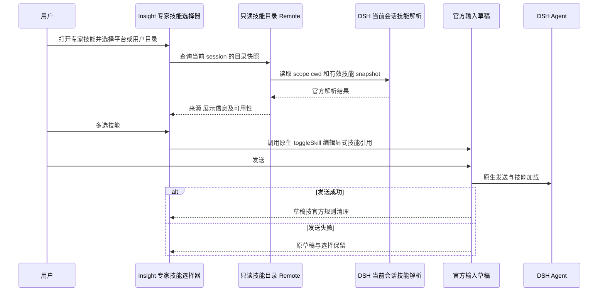

> 冻结历史记录：保留旧 Shell 在记录日期的结论和验收状态，不代表当前实现或线上状态。现行说明见 [Insight 文档入口](../../../README.zh.md)。

# Insight 原生 Desktop P0 设计交付

> 历史阶段记录：下文的阶段状态、待授权描述和运行结果保留当次背景，不代表当前进度。当前状态见 [P5 收口](2026-10-30-dsh-insight-p5-delivery.md)，下一阶段见 [P6 交接](2026-11-02-dsh-insight-p6-handoff.md)。历史失败保留，不将未复验项记为通过。

日期：2026-10-28（Asia/Shanghai）。状态：P0 已获用户确认，P1 已确认并阶段提交，P2 已授权、尚未开始实现；本页保留 P0 设计与随后确认的范围修订。上位规范为[执行报告](2026-10-28-dsh-insight-execution-report.md)。本阶段只修改文档与资产盘点文件，不修改 DSH 代码、不创建分支、不迁移源码、不发布制品。

## 1 本步结果和确认范围

本步将执行报告落实为专家技能清单、插件管理规则、源码来源、官方文件改动候选、数据与更新设计，以及下一步的修改范围。源码基线仍为执行报告第 2 节的四个提交；调查时未发现源码变化。

本步确认只表示设计与后续 P1 范围获准，不表示全部 U 项可以一次性实施。P1 结束仍需停下确认，不能自动进入 P2。实际收费业务、生产投放和删除旧数据不在本步范围内。

| 决策 | 结果 | 对实现的约束 |
| --- | --- | --- |
| 四个随包组件 | 用户确认 Integration、Canvas、Memory、Prompt 均为必需组件 | 新装和升级均保证组件存在；整体停用/卸载不作为正常产品操作；内部可选模块仍保留各自开关 |
| Memory 来源 | 用户指定 `csyangwen/dsh-memory-evolve` | 固定源码快照加父仓补丁，不使用 submodule，不自动切最新分支 |
| Prompt 来源 | 用户指定 `rongxingda/dsh-prompt-enhance` | 固定源码快照加父仓补丁，保留现有适配，不创建维护 fork |
| 营销灵感库 | 用户确认先保持现状，后续作为争议点处理 | P1 不改其服务地址、fallback 或业务协议，不擅自改造成统一代理 |
| Client | 沿用官方工作区和标题栏，名称/图标用现有“因赛AI”资产 | 当前不建立独立 insight-client；确有广泛差异时另行提交设计 |
| 历史对话 | 发布必须保留原账号全部历史对话、分支及相关资源 | P4 实现并验收原生列表可见、打开、继续；P5 原地升级再次验证，重登不清空历史 |
| i18n | 用户明确当前不做 Insight 多语言适配 | 以现有中文流程验收，保留已有资源和官方 locale；相关检查失败按范围外记录 |
| 执行节奏 | 用户已确认进入 P1，阶段结束继续等待确认 | P1 不自动进入 P2 |
| 内置技能范围 | 根目录 `bundled-skills` 是外部仓库同步目录 | 保留目录和同步形态，不检查或改写技能内容，不验证技能业务正确性 |

## 2 目标结构与管理规则

```text
packages/insight/
├─ desktop-integration/             必需：Desktop/Host/Client 分面
├─ canvas/                          必需：自有源码迁入
├─ bundle/                          四组件组合与产品配置（后续阶段）
├─ memory-evolve/                   必需：指定上游的固定源码快照
└─ prompt-enhance/                  必需：指定上游的固定源码快照
bundled-skills/                     仓库根目录，保留外部同步结构
patches/insight/                    指定上游源码的适配补丁
scripts/insight-release/            后续阶段的发布适配
```

### 2.1 必需组件的具体语义

四组件跟随已验证的客户端发布组合管理。插件页面说明产品组件属性，阻止正常整体停用或卸载；Memory 的通知、评审等可选模块开关和配置仍按原有语义保留，不能把必需组件解释成全部模块强制开启。

现有用户若已整体停用或删除其中组件，迁移时恢复组件并解释这是新版产品依赖；保留数据、配置、旧来源记录和可定位归档，不静默销毁自定义内容。旧组件来源与新 runtime 不兼容时进入明确的修复/诊断流程，不能把未知来源当已验证默认组件继续启动。其他第三方插件继续保留来源和用户选择。

故障诊断可以按官方安全模式临时隔离组件，显示受限状态，不能把诊断模式当成完整业务工作区已验收。恢复或安装前完成版本和资源核对，不在每次启动无条件重新安装全部依赖。

### 2.2 源码来源与适配策略

| 组件 | 固定源码输入 | 必须承接的既有适配 |
| --- | --- | --- |
| Canvas | 当前本地源提交 `6a2f8c2fb5ed0a2bb4798ba6c07b48cc88a71e11` | Host/Client 资源与工具契约，按当前 DSH 公开接口适配；版本回退问题先校正来源记录 |
| Memory | [上游提交](https://github.com/csyangwen/dsh-memory-evolve/tree/c337dc1af7b5c8a5578e03150bf5c4d6133f66f9)，manifest `0.1.0` | Client 服务/会话导航迁移，11 类本地路由认证，目标 DSH peer 与共享模块 |
| Prompt | [上游提交](https://github.com/rongxingda/dsh-prompt-enhance/tree/4dc6a140d2b6c59305edb8c74aaed639b71d7291)，manifest `0.2.7` | `attachmentIds`、当前配置表单服务、实际 Harness 主题，不丢现有构建时适配 |

以上 Memory/Prompt 提交与已接受归档的来源记录一致，已通过 GitHub 只读获取对应 manifest 和构建脚本；没有采用上游最新 HEAD，也没有导入源码。

用户在明确安装前依赖解析问题后，选择固定源码快照加父仓补丁，不使用 submodule。导入时从固定上游提取有用途的源码、资源、测试和许可，承接源码适配后一起提交到父仓；实际 workspace 直接读取已适配的 manifest 和源码，禁止先安装旧依赖、再到构建副本中补救。

每包记录上游 URL、commit、输入摘要、保留/排除文件和适配差异。父仓补丁是相对固定输入的可复现差异，由当前源码生成并校验，不手工维护另一套独立实现。正常安装/构建不重新应用补丁或修改已提交源码；同步上游时在隔离目录重放和评审，再提交更新后的源码与差异。移除已被上游替代的补丁，不创建新 fork。

Memory 上游构建脚本只明确构建 Client，并依赖 `DSH_SOURCE` 查找构建工具；不能将“该脚本成功”当成 Host 已从源码重建。P1 必须核对 Host 文件的源/产物归属：若上游把权威 Host JavaScript 放在 `lib`，需要明确源文件存放和产物复制/构建方式，保证 DSH clean 不删除原始源码。Prompt 则分别构建 Host 和 Client。两个组件均需固定源码、补丁摘要、根依赖锁及资源清单。

P1 不保留无消费者的旧兼容分支。必须保留的适配进入源码补丁，不能把父仓旧归档适配脚本原样复制成长期运行机制。

## 3 专家技能专项冻结

### 3.1 清单和来源

当前 `bundled-skills` 包含 15 项技能、322 个非缓存文件，约 4.26 MB 源资产。逐文件路径、大小、SHA-256 和每技能树摘要见[机器可读资产清单](2026-10-28-dsh-insight-p0-skill-inventory.json)。该清单是 P0 历史资产记录，不声称每项已在当前账号可调用或真实业务链已通过。用户随后明确技能正确性不在本次迁移范围，该清单不作为后续逐技能内容/业务验收要求。

| 编号 | 显示名称 | 目录 / 实际调用名 | 主要依赖与迁移重点 |
| --- | --- | --- | --- |
| S01 | 线下活动查询 | `activity-search` | `activity-search` 连接、RAGFlow 检索、Python 渲染；保留输出和错误语义 |
| S02 | 品牌活动监测 | `brand-campaign-monitoring` | `tikhub` 代理、Python 探测与来源采样 |
| S03 | 画布工作流智能构建 | `canvas-workflow-builder` | Canvas 工具、插件 guidance、Python 计划/布局/完整性检查；更新旧能力说明 |
| S04 | 品类与竞品洞察 | `category-competitor-insight` | `tikhub`、Python 校验、输出数据及来源约束 |
| S05 | 创意发想 | `creative-generation-evaluation` | 技能正文和参考资料、模型及对其他技能的调用；无独立业务脚本不等于无依赖 |
| S06 | 达人深度背调与品牌合作风险 | `creator-due-diligence` | `tikhub`、Python、查询记录/锁和证据引用 |
| S07 | 达人推荐 | `creator-recommendation` | `tikhub`、Python 校验、预算及组合输出 |
| S08 | 人性需求洞察 | `human-needs-insight` | 技能正文、Node 逻辑与数据文件；核对实际入口及依赖 |
| S09 | 达人整合营销 | `influencer-integration` | 技能正文/参考资料，以及灵感库、多媒体等被引用能力 |
| S10 | 达人种草策划 | `influencer-seeding` | `tikhub`、Python 数据和测算脚本 |
| S11 | 营销灵感库 | `inspiration-api` | Node/axios、旧独立测试接口及静态 fallback；按用户决定保留现状，标记争议 |
| S12 | 整合营销策划 | `marketing-integrated` | 技能正文、参考资料、模型及组合技能 |
| S13 | 多媒体创作 | `media-generator` | `media-generator` 连接、本地 Node 代理；Python 组参可由既有 JS 调用方式补充 |
| S14 | PPT 制作 | 目录 `ppt-maker-new`；调用名 `ppt-maker-new-new` | `ppt-text`/`media-generator`、Python 3.10+、python-pptx/Pillow/lxml/fonttools，Windows psutil；保留当前候选状态 |
| S15 | 说可策划 | `soccor-proposal` | 技能正文和方法论内容，保持已有拼写及调用标识 |

这 15 项为当前源码和打包目录的资产基线，替代旧 12 项盘点的计数；界面实际可选项仍由 DSH 对当前会话的有效技能解析决定。不得将目录、中文名称和实际调用名混用。PPT 当前正文标记候选验收中，不能在迁移文档中改称正式认证。

### 3.2 技能入口与数据流



官方 `ui-skill` 提供 slash 技能入口，输入区已有 `toggleSkill`，技能加载和同名优先级使用官方实现。官方目录不足以表达 Insight 的来源、排序、遮蔽、无效及扫描不完整状态，因此保留小型产品目录 Remote，由官方 snapshot 生成只读展示，不增加第二个技能注册表，不修改官方 Session skill schema。

当前产品目录有旧 API fallback、轮询和额外扫描稳定逻辑。迁移只保留用户可观察的必要行为，使用目标 DSH 的单一 Remote 路径，优先原生刷新/订阅；不照搬旧兼容猜测、私有类或固定延迟。会话切换和刷新丢弃旧请求；账号切换直接撤销旧 Host 目录访问。

### 3.3 本次迁移只负责接入

`bundled-skills` 保留在仓库根目录，内部目录名、文件和同步资产结构不变，不放入 `packages/insight/bundle`，不拆成 workspace 包，不修改同步来的正文、脚本、测试或资源。沿用现有整目录同步方式，展示元数据继续由目录生成，打包继续整目录复制到 resources 下的 `bundled-skills`。当前历史记录表明该目录由 Codeup 同步；本步不另建新的远程同步协议或自动化。

验证仅覆盖目录和资源接入、目录元数据生成、客户端选择/加载机制及打包路径；交互测试使用合成 fixture，不评价真实技能内容。不运行每项技能自带测试、脚本或后端业务，不核查其参数/算法、PPT 质量、Python 依赖或真实输出，不将技能自身问题作为本次迁移阻塞。

公共选择器仍保留平台/用户分组、搜索、多选、可用性反馈、成功清理、失败保留和会话/账号隔离。这里只验证客户端机制，官方技能解析继续负责实际技能选择；不为迁移修正来源仓库的数据或调用名。

### 3.4 保留的争议点

`inspiration-api` 的脚本仍直连旧测试接口并带静态 fallback，部分技能正文也引用旧网关。根据用户决定，P1 原样迁移这些行为，不改成新代理，不把静态结果当新鲜后端验证。后续独立任务再决定环境配置、统一代理和 fallback 语义，不能为“统一架构”越过本次范围。

## 4 最小宿主接入设计

### 4.1 启动、Home 和账号服务

Insight 的登录前流程直接复用现有认证协议和用户 ID，不引入新的 OAuth 协议或另一个登录 Host。原生登录 UI 和凭证模块来自 Shell 需求，按 DSH 的窗口安全和 UI 基础实现；当前不为 Insight 增加多语言适配；桌面载体只调用产品接入并接收明确账号上下文。

账号范围继续使用旧 `accountScopeKey(environment,userId)`，全局 userData 保持 `<appData>/insight-desktop`。P4 直接复用账号根的 `harness`；`harness-native` 只在已存在时保留，不自动合并。保留旧 scope，不把新账号误落入公共 `~/.dsh`。

每次 Host 创建绑定账号和本次启动标识，输入明确 Home/profile/env，关闭旧 Host 并清除 URL、cookie、boot injections 和账号消费者后才能建立下一账号。现有 host-process 已支持 projectDir 和环境，无需改造为新的通用运行时工厂。

Host 凭证请求由 Integration 统一提供服务，模型、搜索和迁入 Canvas 消费同一账号能力，不各自维护 IPC 和刷新器。主进程只接收受验证的凭证请求及 request ID，核对账号、Host 实例和生命周期后回复；登出/切换/停止撤销未决请求。保留严格并发和超时限制，用当前配置方式表达可调参数，不照抄数字作为新常量。

当前 host-process 会把未知子进程消息判为非法并停止 Host，故这里确需宿主修改；普通 Host 插件增加监听不能解决。优先在 host-process 增加有限、类型明确且由产品接入处理的账号消息分支；不新增任意 IPC 转发或通用插件容器。Host 载体自身可继续运行原 profile runner，不预设必须修改 desktop-host 的启动代码。

### 4.2 具体文件候选

下表是设计定位，不是本步修改记录，也不是一次批准全部后续阶段。P1 只改第 8 节限定部分，其余分别在 P2/P3/P5 实施前确认。

| 项 | 必要或条件修改的官方位置 | 复用和收敛 |
| --- | --- | --- |
| U01 | `apps/desktop/src/main.ts` 的 main/showWelcome/reconcileBackend；产品 Welcome 入口及必要 preload/bundle 产物 | 产品页面与认证放 Integration；窗口安全和生命周期采用官方，不造动态宿主插件系统 |
| U02 | `apps/desktop/src/main.ts`、`paths.ts` 的 Home 决定与账号上下文传递 | 复用 project-manager、host-process 的明确 projectDir/env 参数；不额外改造 factory |
| U03 | `apps/desktop/src/host-process.ts`、`main.ts` 的受限账号请求与取消 | 默认不改 `apps/desktop-host/src/index.ts`；Client 仅有 current/subscribe/signOut/info 类安全桥 |
| U04 | release、core-package-set、runtime-tree、project-manager，以及 prepare-dsh、development-project、package-target、desktop-upload-plan、builder | 明确拆产品版本和 runtime 版本，更新实际消费者；不全仓改版本 |
| U05 | P1：`apps/desktop-host/package.json` 的产品闭包依赖及根构建引用；P2/P3：`project-manager.ts` 的默认产品 bundle 选择 | P1 只用测试专用显式 profile，不改变默认启动组合；package-set 已递归收集依赖，先复用 |
| U06 | update source/provider 接入、channel/schedule 的选择及必要 coordinator 注入、发布脚本 | 提取既有 V2 信任和目标绑定，下载/安装只用原生执行器 |
| U07 | `main.ts` 安装前回调和 Host 状态记录、启动/更新测试 | 协调器现有停机/恢复能用则不改；无 Host 不能等于对象 undefined |
| U08 | 预计仅 Insight Client/Host 包和其 Remote | 复用 slots、toggleSkill、技能 provider；不预先改 `packages/client/ui-*` 或官方 skill schema |
| U09 | builder、NSIS include、卸载清理及产品构建身份 | 保留旧 Insight 安装语义，用实际签发制品核对，不直接套官方安装默认 |
| U10 | `microphone-permissions.ts`、`main.ts` 安装策略，以及产品 Welcome 对应权限策略 | 只限定 Insight 产品路径，保留官方默认产品行为；默认拒绝，不放宽 webSecurity/IPC |

对应行为测试归属于 apps/desktop 及 Insight 包；版本和制品校验同时更新运行、开发和打包消费者。每项落地前把实际文件及测试补入官方改动台账，不把未修改候选登记成已修改。

### 4.3 权限和页面范围

复用标题栏和窗口状态，不沿用更宽的非 media 默认许可。权限逐项核对 owned WebContents、当前账号实例、可信来源和 frame：主页面音频按官方 OS 授权；必要的剪贴板写入和受控 Canvas fullscreen 保留原产品允许范围，外部页面及过期内容拒绝。

不能简单要求全部权限仅 main frame，因为现有 Canvas 的受控 iframe 有 fullscreen 需求；也不能允许任意 iframe。登录页无业务凭证和 Host cookie，非必要权限拒绝。由 host/native 持有可信绑定，页面自报 Origin 不作为信任根。

## 5 数据迁移冻结设计

P2/P3 使用全新隔离 Home 或独立副本，不运行生产旧 Home。P4 直接将旧 `harness` 作为 canonical Home，不使用第二个长期 Home，也不建立迁移状态、profile 暂存、数据转换或定时任务兼容。启动前明确 canonical Home，同一账号新旧 Host 不能同时写。

Session 世代、附件、成果、插件配置和业务数据均由既有拥有者保留。P4 不承诺将仅存在于 `harness-native` 的预发布数据导入 `harness`；该情况停止启动并留给人工恢复。

## 6 发布和更新冻结设计

### 6.1 版本与安装身份

| 项目 | 已能固定的值或规则 | 仍需实物验证 |
| --- | --- | --- |
| appId | `com.insight-aigc.desktop`，本机 1.0.8 包 manifest 及签名描述均可读 | Windows 实际 uninstall identity，线上 1.0.9 签发包对照 |
| 品牌和目录 | 产品名 `因赛AI`；`<appData>/insight-desktop` | 旧安装 exe/uninstaller/cache 名称及自定义安装范围 |
| 产品版本 | 对齐 Shell 基线 `1.0.9`；P5 首个新内测包 `1.0.10-rc.1` | 实际线上版本与旧客户端接入路径 |
| DSH runtime | 独立记录 `0.2.2-alpha.2` 及目标 commit | 首包实际构建记录 |
| 渠道 | P5 新实现支持 rc，不沿用旧 Shell V2 的 final-only 限制；正式渠道仍只接收正式版本 | 新 rc 发现适配、旧 V2 final-only 客户端的兼容限度及各平台制品 |
| 签名 | 本机 macOS arm64 1.0.8 描述的 Team 为 `8P39WV82RX`；保持 Insight 身份 | Developer ID 完整链、线上包、公证有效性；Windows 历史签名/发布者连续性 |

旧 Shell Windows 设置包含 `verifyUpdateCodeSignature:false`，DSH 默认要求签名且安装目录策略不同。因此不能凭配置推断旧包有可连续的 Publisher；也不能在迁移时关闭 DSH 校验掩盖不兼容。P2 早期真实包核对身份，P5 完成原地升级矩阵后才可投放。

本机 `/Applications/因赛AI.app` 是 arm64 `1.0.8`，不是当前开发 Electron 或已证明的线上最新包。只读 Info.plist 得到 executable/name `因赛AI`，Helper 标识为 `com.insight-aigc.desktop.helper`、`.helper.GPU`、`.helper.Plugin`、`.helper.Renderer`；`codesign -dv` 能读取上述 Team 及 stapled ticket 描述，但本步不据此声称签名链和公证验证通过。迁移保留这些身份，并在 P2 对目标线上包复核。

发布证书、私钥和 bucket 凭据不写入文档或代码，不要求在聊天中提供。实际在投版本、完整签名有效性和 Windows registry 身份本步未核验，作为 P2/P5 前置检查，不影响 P1 源码接入。

### 6.2 V2 信任与单一执行器

保留既有签名 rollout → release index → target manifest → updater metadata 单文件/名称/大小/sha512 的绑定，以及 anti-replay 和环境/平台检查。旧客户端只能通过原 V2 命名空间识别正式版本；新客户端支持 rc，并接入 DSH 单一协调器，不引入第二个 UpdateManager 或轮询循环。P5 构建以 DSH 为主，发布以 Shell 为参考，具体分工和旧客户端限制见 [P5 补充计划](2026-10-30-dsh-insight-p5-plan.md)。

当前 stable 指针为 `desktop/stable/current.json`，candidate 为 `desktop/candidate-v2/<target>/current.json`，不可变目标在 `desktop/releases/v<version>/targets/<target>/`。保持 OSS/CDN，来源由可信产品配置决定；不把 generic feed 当独立信任根。安装目标一旦绑定，下载器不得自行切换到未验签的新 metadata。

用户在 P5 补充中确认完全沿用 Shell 的内测手动检查：更新窗口图标 3 秒内点击 5 次，风险确认后检查，后台只自动检查正式版。这替代此前 opt-in 后自动发现内测的要求。统一目标解析负责 required stable 优先 optional candidate、版本更高及不降级；相同版本切换归属可复用字节，rc 转正式因包内版本变化需构建正式包。

安装前通过原生任务检查/锁定/停止处理 Agent、Canvas 手工任务和外部 CLI。无 Host 安装需要证明从未启动或已 clean stop；starting、unknown、unclean、残留进程先核对，无法证明则阻止安装。取消或安装未接管且已停机时，恢复当前账号 Host。

## 7 风险、验证和未定项

| 风险或未定项 | 本步处理 | 后续完成点 |
| --- | --- | --- |
| 必需组件与旧停用/卸载状态冲突 | 用户已选择四个必需；保留数据/来源记录并说明恢复原因 | P3/P4 验证组件修复和用户数据不丢 |
| 上游没有现成 rc.2/新 DSH 适配 | 固定源码快照加父仓补丁，安装前即具有正确 manifest，承接既有变化 | P1 构建可复现，P3 组合行为通过 |
| 专家技能同步形态变化 | 保持根目录和来源内容，不修改调用名 | P1 目录/元数据/资源接入，P3 选择加载；不做技能正确性验收 |
| 灵感库旧接口/fallback | 按用户决定保持，登记争议不扩大本次范围 | 独立后续任务处理 |
| 技能自有运行依赖或质量问题 | 保持来源内容，不新增运行时分发体系 | 不在本次迁移检查范围，来源仓库另行维护 |
| macOS/Windows 身份未知 | 保留已知 appId/userData，不假造签名或 GUID | P2 实物检查，P5 安装矩阵 |
| 产品/runtime 版本耦合 | 已定位运行、开发、构建消费者 | U04 实现及相关测试 |
| 官方权限更宽、Canvas iframe 又需全屏 | 产品级显式 allowlist，保留必要受控 frame | P2/P3 允许和拒绝矩阵 |
| Core 特殊历史格式 | 不修改冻结世代，不跑真实旧 Home | P4 样本与后继修复 |
| 大量官方差异 | 按实际文件和 U 项登记，不先分叉 Client | 每阶段复核及每次基线同步 |

## 8 下一步 P1 的可批准范围

P1 目标是源码和受控构建接入，不是完整客户端发布。用户确认本步后，再创建 DSH `insight` 分支；不得切换或重置用户未提交改动。

P1 允许的新内容：`packages/insight` 下产品包、Canvas 及 Memory/Prompt 固定源码快照、父仓源码差异和必要构建辅助、bundle 产物与资源清单、对应测试和文档。官方文件只限这一步必需的 workspace/依赖锁、编译引用、构建注册、产品包分类及闭包依赖；具体变更进入台账。U01/U02/U03/U04/U06/U07/U09/U10 的运行行为不在 P1 顺带实施，U05 的默认 project-manager/profile 选择也不在本步修改。

如果编译必须先修改上述宿主运行接口，停止该部分并提交具体依赖，不靠空实现、吞错、旧 SDK 安装或跳过类型检查使构建变绿。P1 可以完成源码和独立产物接入而明确尚未激活完整业务组合，不得据此宣称登录、插件云业务或完整 runtime 已验收。

P1 交付：分支和来源可追踪，Canvas 迁入输入固定，两个源码快照与差异可重现，依赖不引入第二套 DSH，资源在构建物中，必要检查实际通过或有清楚阻塞。只在隔离显式 profile 做必要 smoke，不改变默认桌面启动。阶段结束列明实际改动和验证，再等待用户确认 P2。

## 9 本步验证记录

已只读核对四仓基线、专家技能目录/显示元数据/脚本依赖、官方调用点及 Shell 原有适配；已通过连接器读取用户指定上游的固定提交 manifest 和构建脚本；已读取本机 1.0.8 app 的安装/签名描述；已生成 15 项技能的资产摘要。未导入插件源码、未创建分支或 fork、未修改 DSH、未运行产品代码或收费接口。

本步交付包括本设计、更新后的执行报告和机器可读技能清单。实际检查通过：两份 Markdown 共 50 个本地链接/锚点、7 张 Mermaid 图语法、F01–F21/U01–U10 编号完整性、15 项技能的 322 个文件/4,263,088 字节摘要，以及仅三个交付文件的工作区变化。独立只读复核已通过，源码适配和默认 profile 的阶段范围冲突已修正。

P0 已确认，P1 获准执行；其中内置技能范围以上述用户修订为准。产品构建、真实安装、线上指针和业务结果留在明确后续阶段，不作为本步通过证据。
