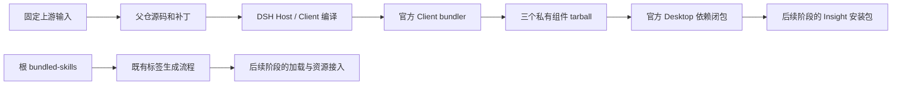
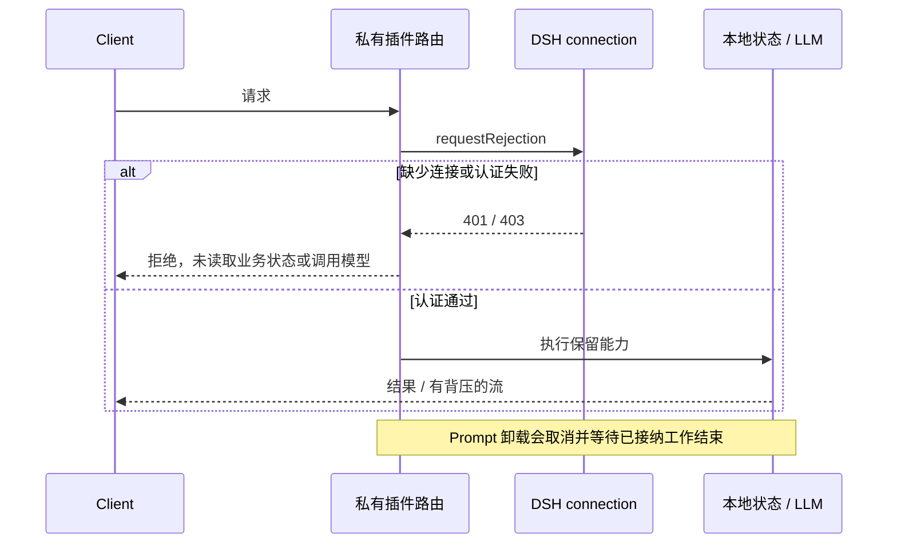

> 冻结历史记录：保留旧 Shell 在记录日期的结论和验收状态，不代表当前实现或线上状态。现行说明见 [Insight 文档入口](../../../README.zh.md)。

# Insight 迁移 P1：源码和构建接入

创建：2026-10-28；收尾验证：2026-10-29（Asia/Shanghai）。状态：P1 已由用户确认并完成阶段提交；P2 已完成返工和前置模型可对话闭环，等待用户确认；见 [P2 交付报告](2026-10-29-dsh-insight-p2-delivery.md)。本文记录本阶段的实际变化及验证范围，不表示完整客户端已经迁移完成，也不构成 P3 或生产发布授权。完整结果见 [机器可读验证摘要](2026-10-29-dsh-insight-p1-verification.json)。

## 本阶段范围

DSH 已切换到用户指定的 `insight` 分支。Canvas、Memory Evolve、Prompt Enhance 迁入 `packages/insight`，接入官方工作区、Host/Client 编译和桌面打包闭包。现有默认 Desktop profile、启动、登录、原生标题栏和客户端 updater 尚未替换。

Integration、Canvas、Memory、Prompt 的必需组件策略仍按 P0 执行；Integration 的原生启动与账号实现属于 P2，当前没有创建空壳包来代替实现。

用户已确认：P1 修好接入入口、声明和包元数据；历史业务断言、路由规范化原定 P3；用户随后明确当前不做 Insight i18n，文案多语言迁移及 locale 元数据补齐从当前范围移除。Memory 的独立 Git 更新功能退役，四个必需组件统一随 Insight 客户端版本更新。2026-10-29 用户进一步确认：P1 关闭新增 12 项依赖准入和共享 UUID helper 问题，剩余固定业务源码 lint 纳入 P3。保留原检查，不扩大旧断言基线，不建立全局豁免。

## 结构和变化

```text
deepseek-harness/
├─ packages/insight/
│  ├─ canvas/                保留原插件标识；iframe 单独构建
│  ├─ memory-evolve/         固定源码；Host 原始 JS 位于 src/host
│  └─ prompt-enhance/        固定源码；适配当前 DSH API
├─ bundled-skills/           保留根目录、内部结构和整目录同步方式
├─ patches/insight/          三个包相对于固定输入的完整补丁
├─ scripts/
│  ├─ insight-package-policy.ts
│  ├─ verify-insight-source-patch.ts
│  └─ generate-skill-presentations.mjs
└─ docs/subsystems/
   ├─ insight.md
   └─ insight-baseline-changes.md
```

基线为 P0 冻结的四仓源码，收尾期间没有重新拉取或合入远端更新，避免改变本阶段验收对象。DSH 代码已提交到 `insight`，源码提交记录见机器可读验证摘要；尚未推送或发布。

三个包保留旧 loader 标识，均为私有包，版本随 DSH 根版本。精确清单约束名称、唯一目录、私有状态和发布元数据；公开 npm baseline 排除这三个目录，不为其他私有包建立通用豁免。三个包不再导出未随包交付的 `./src/*`。

桌面 Host 声明生产依赖；官方打包阶段另行打入这三个私有组件，再交给原有闭包选择器。单纯增加依赖不足以完成打包：公开 release family 会跳过私有包，因此本阶段增加了这一明确的打包步骤及正反例测试。具体官方文件差异以 DSH 的 [基线修改记录](../../../baseline-changes.zh.md) 为准。

### Canvas

保留工具、桥接、鉴权路由、成果来源、会话引用、常驻服务和原业务 iframe。上传策略中被 Host 和 iframe 共用的纯代码移动到 `src/shared/upload`，避免 Host 编译跨入 iframe 根目录；文件名 UUID 使用 DSH 已有 `dsh-util-crypto`，兼容普通 HTTP 页面；未重写 UUID 实现。iframe 保留自身 React 版本，通过根锁管理依赖；对旧 Framer Motion 的三个传递依赖边恢复原锁中的兼容版本，不改变 DSH 其他版本。

Canvas 使用官方 Client bundler，并在构建完成后生成 iframe 产物和包内 guidance。旧仓库专用发布/验证脚本没有作为运行时依赖迁入；对应无消费者的验证测试删除。三项原来按旧 Core 路径条件跳过的会话投影测试改为直接验证当前 DSH。

Canvas 原生自定义来源、账号凭证和完整云生成仍属于后续接入，不以源码测试代替真实客户端验收。

### Memory Evolve

固定输入为用户指定上游的已记录提交，采用源码快照加父仓补丁。上游仅以 JS 提供的 Host 迁入 `src/host`，不把旧 `lib` 当成构建前提。构建生成薄入口，并复制真实 `lib/host` 模块树；复制前只清理该自有目录。同步 worker、Mermaid、skills、seed 的相对路径随实际运行位置适配。

所有保留的本地 Web 路由在解析或操作状态前检查 DSH connection；缺少服务返回 401。Client 适配当前图标、会话跳转和 renderer API。独立 Git updater、HTTP 更新操作、版本更新页及专属轮询链路删除；Memory 数据同步中的 Git 能力保留，不能与组件自更新混为一谈。

### Prompt Enhance

保留增强、预览、应用、撤销、流式输出及配置能力，改用当前 DSH 设置表单机制、附件字段和主题方式，删除已不存在的设置兼容探测。

HTTP 路由先执行 DSH connection 认证，再执行原 Origin/loopback 限制。路由由 Cordis effect 持有，卸载时停止接收、取消并等待在途请求，最后完成资源清理；请求体读取和模型迭代都接收取消信号。异步 delta sink 和 iterator cleanup 均被等待，避免慢客户端累积输出以及卸载后继续使用 LLM。

保留功能的测试改为 DSH 的 `.spec` 命名；仅依赖已删除设置安装流程和旧 committed-lib 布局的测试退役。

### 专家技能

根 `bundled-skills` 原样同步，未迁入插件子包。沿用 Shell 的目录到显示元数据生成方式，读取调用名及 `ui.json`，生成 `build/skill-presentations.json`。脚本仅把 YAML 解析库换成 DSH 已有依赖。

本地双语文档检查和 vendor 重写流程排除这个外部同步目录，避免改写源仓库资产。没有执行内置技能脚本、验证内容正确性或验收业务输出。加载和打包接入不构成技能功能全部通过的声明。

## 构建与请求数据流





## 可复现输入

每个包的 `upstream.json` 记录仓库、提交、输入摘要和补丁路径。Memory/Prompt 使用固定归档；Canvas 使用固定本地提交和记录的路径清单生成归档。构建直接使用父仓源码，不在安装后打补丁，不自动追踪远端分支。

`verify:insight-source` 接收包目录和本地归档，先核对 SHA-256，再在自有临时目录提取和应用包根相对补丁，比较完整文件清单与逐文件内容，最后清理。它不访问网络，也不写入工作树。旧上游 `lib` 必须在补丁中显式删除，不能以“生成物”为由跳过比较。三个真实输入的回放已验证。

## 已通过的验证

| 验证 | 结果 / 范围 |
| --- | --- |
| 源码准入、公开发布排除、产品分类、标签生成定向测试 | 213 项通过 |
| 桌面打包阶段和私有闭包正反例 | 69 项通过 |
| Canvas Host / Client 回归 | 418 项通过，零条件跳过；直接使用当前 DSH 投影 |
| Prompt | 210 项通过，覆盖认证、路由重挂载、背压、取消、卸载等待 cleanup gate |
| Memory | 9 项通过，覆盖 fail-closed、资源复制与 stale 清理、真实 worker 导入、bundler 依赖过滤和 CSS 解析 |
| 固定源码回放工具 | 4 项通过；三个实际归档回放通过 |
| Canvas iframe | 38 个文件、476 项测试通过；实际 Vite 构建通过，保留已有大 chunk 提示 |
| 专家技能标签生成 | 通过；仅验证接入流程 |
| 工作区约束与默认产品隔离 | 通过 |
| 构建产物 `build:artifacts` | 8 项通过；生成 368 个 Client 产物 |
| 构建后的 `build:check` | Host、Client 两项汇总类型检查通过 |
| 实际 Loader | 1 项通过；新建临时 Home，经 DSH Web profile 加载三个真实 Host 产物，验证工具挂载及未认证路由拒绝 |
| 最终组件 tarball | 三个实际包均通过导出目标、声明、Client 注册及必要资源检查；无 `lib/types` 中间 JS，Memory 包不含已退役 updater |
| 入口分类与 vendor 同步保护 | 81 项定向测试通过 |
| 导出依赖分类与拒绝行为 | 61 项通过；包含真实临时源码读取、拒绝 tools 私有副本依赖、修复为 peer+dev，以及拒绝未审查的同包导出 |
| UUID 回归 | 先在旧实现复现 `crypto.randomUUID is not a function`；修复后扩展名与无扩展名两条路径通过，子进程隔离全局状态 |
| iframe 上传凭证 | 10 项定向测试通过；配置从 iframe 自身目录执行 |
| 完整依赖准入 | 通过；原 12 项及随后声明核对发现的 4 项均关闭 |
| NodeNext 消费 | 最终构建后 381 个 workspace 包声明 API 编译通过 |
| 本轮定向 lint | 导出策略、依赖测试、上传 helper 及对应回归测试通过 |
| 持久化声明扫描 | 86 项测试通过；引用项目含 JS 时仍扫描其 TS 声明 |
| 历史来源读取兼容 | 34 项既有读者测试通过；新增两种 Canvas 信息来源已记录类型确认，不变更 Session 写入版本或用户数据 |

独立审查已经闭合 Prompt 鉴权/生命周期/流控、Memory 组件更新/资源/worker 及 Host 导出分类的实质发现。主线程单独负责 Canvas，审查者未读取 Canvas 源码。构建环境使用临时 Node24；其原生插件编译头文件取自官方 Node 的稳定 Node-API v8，不改变仓库构建脚本。

## 未通过的检查与处理归属

以下失败均保留为失败，不能用“构建通过”替代。完整 hygiene 为 **19 项通过、4 项未通过**；doc-sync 为 **42 项通过、1 项未通过**；test:docs 为 **20 项通过、1 项未通过**。四项 hygiene 失败中，路由与旧断言归 P3；UI i18n 与 locale 元数据两项现为用户明确的范围外，不再要求 P3 补齐。剩余固定业务源码 lint 仍归 P3。依赖准入和本阶段新增 UUID helper 已修复；完整检查没有被跳过或改为放行。

| 检查 | 当前结果 | 处理与验收归属 |
| --- | --- | --- |
| `verify-client-ui-i18n` | 382 处历史文案或检测误报 | 当前范围外：不做 Insight 多语言迁移；保留该次失败事实，不改全局检查 |
| `verify-locale-metadata` | Memory/Prompt 目前提供 en、zh，缺少其余六个 DSH 交付语言；检查首先报告缺少 ja | 当前范围外：不要求补齐其他语言，保留已有 en/zh 资源 |
| `verify-client-route-resolution` | Prompt 有 2 处以 `/` 开头的应用路由 | P3：适配 document-relative 解析，覆盖非根部署路径和请求认证 |
| `verify-no-unknown-casts` | 固定输入迁入 43 处业务或测试断言 | P3：在拥有者处改用真实类型或输入解析，更新消费者；禁止扩充 baseline 掩盖 |
| `pnpm run lint` | 上轮全仓运行记录 46,069 个错误、9 个警告；本轮修复后未重复全仓运行，不能视为当前精确数量或通过 | 用户确认剩余固定业务源码 lint 归 P3；本轮改动的定向 lint 已通过 |
| `doc-sync` / `test:docs` | 均只有 repository references 失败：`python/sdk/uv.lock:113` 含 commit hash | 文件未修改，属于当前基线失败；未擅自清理 Python 依赖锁 |

P3 除已批准静态项外，还需完成原生界面融合、实际功能对照，以及 Prompt 辅助模型调用的持久日志对照。P1 的 Loader 测试没有启用真实账号或云模型，不等同于 GUI 全功能验收。

### 本轮关闭的依赖准入问题

原 12 条诊断及随后暴露的 4 处声明差异已按拥有者处理：Canvas 删除根仓已提供的本地 `@types/react` 声明；Host 导出采用精确分类；Canvas 和 Prompt 的实际 manifest、根锁及源码补丁同步更新。普通值依赖进入 `dependencies`，需要共享错误类身份的 tools 依赖保留匹配的 peer+dev。仅以类型使用的 attachment/fs 留在 dev；已声明的 Client attachment 注入补齐 dev 依赖。OSS 加载拆成局部 `require` 绑定和字面量调用，保留原来的惰性 CommonJS 行为，使依赖扫描能看到真实运行时使用，`ali-oss` 继续随运行包交付。

`createUserMessage`、`BlockAssembler`、`domainTable` 返回结构值或持有调用方局部状态，因此仅这三个导出新增 safe 分类。`defineTool` 保持 shared peer：其参数校验抛出的错误必须由 Host pipeline 按同一个 `HarnessError` 构造器识别，不能依赖安装器恰好去重。没有将整个 provider 包放入 duplicate-safe，也没有改造官方错误协议。

独立复核识别并闭合了上述 `defineTool` 身份问题。新增测试从真实临时 Host 源码读取导出使用，验证普通 tools dependency 被拒绝、修复为 peer+dev 后通过；LLM/storage 的未审查默认或 `apply` 导出仍被拒绝。最终分类及后续 PR 的显著披露要求已写入 [基线修改轨迹](../../../baseline-changes.zh.md#host-值依赖分类)。

### 全仓 lint 的具体范围

上轮全仓 lint 中，44,916 项为 `@stylistic` 规则，另有 1,153 项非格式规则；按包统计为 Canvas 43,963、Memory 1,918、Prompt 188 个错误。主要非格式问题包括 void 表达式、冗余条件、unsafe 成员访问、弃用 API、非空断言及 Promise 处理，不能批量格式化后宣称解决。9 个 warning 中有 1 个来自未修改的官方包，其余来自迁入包。

共享上传文件名 helper 已改用 DSH 已有 UUID 实现，修复本阶段新增的普通 HTTP 兼容问题。回归测试在独立子进程关闭 `crypto.randomUUID`，保留 `getRandomValues`，旧实现确定失败、修复实现通过。其他旧 Client 的相关调用随 P3 的对应功能迁移处理，未放宽浏览器 API 检查。

P1 原有 24 个接入工具、打包测试与 Loader fixture 的定向 lint 已通过；本轮新增策略、helper 和测试也已通过定向 lint。剩余业务源码 lint 已由用户确认纳入 P3，这些局部证据不能替代全仓 lint。

## 保留风险和后续门禁

- P1 没有触碰真实历史 Home、账号数据、旧会话或线上发布渠道。原地升级和历史数据保留必须通过 P2/P4/P5 的实物安装与迁移验收。
- Canvas 与 Memory Client 保留上游 `strict` 设置，但暂不启用 DSH 额外的精确可选属性和索引访问检查；没有降低全局编译设置。Memory 原始 Host JS 不等于完整静态类型证明。
- 完整 hygiene 尚未全绿；P3 必须关闭范围内的路由与旧断言检查；i18n 两项按范围外记录，不把本阶段分阶段验收解释为可发布。默认产品 profile 未挂载这些组件。
- Canvas 原生来源和账户通道、旧数据映射、测试版发现、OSS 上传、签名身份及安装更新链路仍需后续阶段验证。
- 上游补丁较大，主要包含旧打包产物和未保留材料的删除；更新固定输入时必须重新回放，不能仅比较少量关键文件。

## 最新范围补充

用户再次明确：P2 迁移原生登录、账号 API 及“因赛AI”名称/图标，P3 迁移统一模型、搜索、技能等业务服务；当前尚未实现这些能力。历史对话保留为 P4/P5 发布硬门槛，要求原账号对话在 DSH 列表可见、可打开、可继续，并保留内容、分支及附件/成果；重新登录不能清空历史。完整条款见执行报告第 8 节。当前不做 Insight 多语言适配，P1 的历史检查结果保持原样，不将范围调整写成检查通过。

## 下一阶段范围

P1 已达到用户确认的分阶段交付范围；仓库门禁仍未全部通过，当前组合不作为可发布客户端。新增依赖准入与 UUID 问题已按用户确认处理，剩余门禁归 P3 或既有基线问题；用户已确认 P1 并授权进入 P2；本次先保存阶段提交，P2 尚未开始实现。

P2 已获授权，实施范围为：按已批准设计迁移 Insight 原生启动、登录、账号 Home 和 Host 生命周期，使用全新隔离数据及早期安装包核对应用身份。P2 对官方文件的改动须按执行报告中的具体范围确认，不把本阶段的构建接入授权扩大为任意 Client 修改授权。

## 阶段提交记录

DSH 源码提交为 `413ce141bec951ed001e5398b981beb42a7fd7ab`，包含 P1 固定源码、可回放补丁、同步技能、构建接入及基线修改轨迹。Git 属性保留同步技能和两份 Canvas HTML 的原始字节，避免 5 个 CRLF 文本在入库时转换后破坏回放。1381 个暂存变更文件均已与工作文件逐字节比对一致。

本次提交前实际通过：12 组暂存双语记录、provider 元数据、vendor guard、28 个集成文件的只读 staged lint，以及迁入目录之外的暂存空白检查。按已确认的 P3 和外部资产保留范围，本次没有运行批量 lint 自动修复，也未修剪导入快照/技能/补丁的原有空白。完整暂存空白检查仍返回失败，发现仅位于这些导入拥有者；不把该结果写成通过。适用检查已手工执行后，本次 Git 提交没有重复调用完整 pre-commit runner；没有修改 hook 配置，也没有推送或发布。
