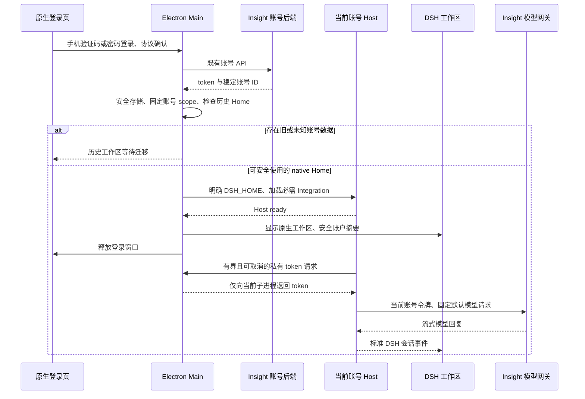

> 冻结历史记录：保留旧 Shell 在记录日期的结论和验收状态，不代表当前实现或线上状态。现行说明见 [Insight 文档入口](../../../README.zh.md)。

# Insight 迁移 P2：原生登录、账号与托管模型

日期：2026-10-29（Asia/Shanghai）。状态：P2 返工与前置模型闭环已完成，用户已确认阶段提交并授权进入 P3；P4 仍需后续确认。本报告以 DSH `insight` 工作树为验收对象，P1 已确认；P2 DSH 源码提交为 `ef5b752aca`；本阶段没有推送、发布或覆盖现有客户端安装。

## 用户反馈后的补正范围

此前原生登录闭环通过，只证明认证、窗口切换和退出有效，不能代表原登录视觉、账号/设置入口或业务对话能力已经恢复。P2 重新打开：复刻 Shell 登录表现，补全账号菜单与产品设置，前置 Insight 管理的固定默认模型并隐藏模型凭证设置；完成后再次停下验收。

只读盘点确认：原正式用户数据根仍有旧 Home 与 2 个会话文件，原开发数据根仍有旧 Home 与 25 个会话文件；未读取会话内容，未复制、转换或改写这些文件。返工模型联调使用 `/private/tmp/insight-p2-rework-user-data`；本轮入口与布局复验使用源码启动器默认隔离开发目录 `apps/desktop/.desktop-build/development/insight-desktop-dev`。两者均与正式旧数据目录隔离，空白列表不能说明历史已删除，也不能说明历史已可迁移。

Canvas、Memory、Prompt 已随包构建，但未进入当前运行 profile；仍不视为已启用。三个业务插件及历史数据转换留在本轮之后分别确认。本轮原生登录、模型回复、账号菜单与设置已完成验证，具体通过项和未通过项见下方验证记录。

## 范围与阶段边界

P2 接入 Insight 登录、账号 API、名称和图标，并按本次确认前置托管默认模型、账号菜单和产品设置，工作区沿用 DSH 原生布局、标题栏、安全窗口和打包机制。Insight 界面使用中文，不实施多语言适配；相关全仓检查保留并如实记录。四个必需组件中，本阶段只激活 Integration，Canvas、Memory、Prompt 的业务接入属于 P3。

历史对话、账号、工作区、插件和配置必须保留。P2 不允许新运行时直接打开真实旧 `harness`：检测到旧目录即停在迁移提示，没有绕过入口。P4 完成 staging、转换和恢复验证后才允许旧账号进入工作区；P5 验证原地升级和签名安装身份。这一阻断是数据保护措施，不能据此宣称历史对话迁移已经完成。

## 变化与结构

- 新增私有包 `packages/insight/desktop-integration`，保留产品自己的登录、账号、凭证和品牌逻辑。
- 官方 Desktop Main 仅负责产品选择、原生窗口、账号生命周期与 Host 进程编排；默认官方产品路径保留。
- 产品版本与 DSH runtime 版本分离：Insight 显式提供 1.x 版本，DSH runtime 仍为其自身 0.2.x；本地验证版本不作为正式发布版本。
- Integration 产品 overlay 关闭官方品牌、官方账号登录及模型路由、产品遥测；不修改官方默认 profile。
- 账号服务通过 Cordis 注册，不建立旧 Shell 的额外 HTTP token 桥、独立启动器或第二套 updater。
- `bundled-skills` 的目录、同步形式及内容不变，没有校验或执行其业务正确性。

实现入口及官方修改轨迹见 [Integration 包说明](../../../../../packages/insight/desktop-integration/README.zh.md)、[Insight 子系统](../../../../subsystems/insight.zh.md)和[基线修改记录](../../../baseline-changes.zh.md)。

```text
packages/insight/desktop-integration/
  src/desktop/   Auth API、认证状态、加密凭证、账号目录保护
  src/host.ts    受信 Host 使用的 Service Definition；独立于 Loader 根入口
  src/host/      ctx.insightAccount 私有 IPC provider、托管 Gateway adapter
  src/shared/    严格 IPC 协议及安全账户摘要
  src/client/    原登录视觉、工作区品牌、账号菜单、产品设置
  resources/     原 Insight 图标
  cordis.patch.yml
apps/desktop/
  src/product.ts / insight-startup.ts / insight-account-exit.ts
  src/main.ts / host-process.ts / project-manager.ts
  src/preload-insight-login.ts / preload-app.ts
  renderer/insight-login.html / insight-legal/
  scripts/       官方打包与开发启动中的产品选择
```

## 数据流与所有权



Main 在读取产品状态前确定名称和 `userData`。正式产品沿用 `com.insight-aigc.desktop` 与历史 `insight-desktop` 用户数据根；开发和实物测试使用独立目录。账号 scope 沿用旧客户端的环境与稳定用户 ID 派生算法，不使用手机号、显示名或数字舍入后的 ID。

凭证只归 Main 所有，正式构建通过 Electron safeStorage 加密。无法解密或暂时不能使用安全存储时保留原文件；显式清除只处理认证文件，不删除账号 Home。写入使用私有目录、随机临时文件、排他创建、同步及原子替换；不跟随凭证及受控父目录链接。

Host 服务只向当前 Main 请求访问令牌，不向 Renderer、Remote、HTTP 路由或工具暴露令牌。独立 `./host` 导出服务定义和结构化错误，包根保持 Cordis 的四个插件导出；Typert 只有服务描述，没有 Remote artifact 或可执行 invocation。双方严格验证消息、UUID、令牌长度和并发上限；取消、断连、退出及迟到响应均有处理。Renderer 只得到显示名、脱敏手机号、头像、版本和退出操作。

每个原生进程固定绑定一个账号。退出或认证过期时先关闭请求准入、隐藏工作区，等待旧 Host 和账号资源停止，清除认证，再重新启动进入登录页。停止结果未知或认证清理失败时禁止重启新账号；认证过期会升级正在等待用户确认的手动退出，用户取消不会恢复过期账号。

## 验证记录

自动替身测试、真实 Loader 组合、实际 Electron 联调和制品检查分别记录，不互相替代。详细记录见 [机器可读验证摘要](2026-10-29-dsh-insight-p2-verification.json)。

| 验证 | 实际结果及证据范围 |
|---|---|
| 完整本地构建 | 官方打包命令内 `build --profile local` 的 10 项检查通过，包含 artifacts 和 Host/Client aggregate；大型检查使用 Node 8GB 堆 |
| P2 源码定向测试 | 返工最终 15 文件、218 项通过；覆盖登录、账号、目录保护、原生 Main、模型路由、启动回滚、请求取消、卸载和品牌 slots |
| 无本包 lib 的 unit 负控 | 临时移开 Integration 自有 lib 后，10 文件、52 项 unit 通过，恢复原产物后继续 built 检查 |
| 真实 built Loader | `real-loader.built.e2e.ts` 通过真实 bundles → runtime resolution → Loader → parent IPC 验证服务激活；由 build 后 keyless gate 执行，非 lib/无 artifacts 正确跳过 |
| Host 导出 built smoke | `host-exports.built.e2e.ts` 验证 root 仅四个插件导出，`./host` 与 provider 的 class identity 一致；两项 built smoke 最终合跑 2/2 通过 |
| 子进程及管理回归 | Host-process 33 项通过；项目管理相关 40 项通过、1 项平台条件跳过；fatal recovery 33 项、preload 26 项、gate runner 153 项通过 |
| 产品与包内容 | 本地 macOS arm64 目录包生成；appId、显示名称、产品/runtime 双版本、图标、登录 JS/CSS/preload 和协议 HTML 均核对；标准原生依赖、CLI 和 Office 转换 smoke 通过 |
| 真实 Electron | 测试账号短信登录 → 默认 DeepSeek-V4.1-Flash → 请求得到 `P2-model-ok` → 账号菜单、Insight 设置、模型菜单 → 退出后登录页通过；使用最终目录包 app.asar 内 DSH Host、开发 Main 和隔离 userData，正式 Main 未启动；旧 Host 端点已关闭。密码/图形验证码只做定向替身测试 |
| 新会话持久化 | 仅对隔离测试目录做只读检查：42 条 Session 记录中确认托管 route 和验证回复，Zstandard frames 完整；这不代替真实旧会话转换验收 |
| 公开导出及依赖政策 | 公开 helper 定向测试 1 项通过；依赖政策测试 61 项通过；8 项新 Host 值均声明为共享 peer，完整依赖准入通过 |
| 新增代码静态检查 | 本阶段新增和修改文件的定向 lint、导出 JSDoc、NodeNext/依赖准入及 whitespace 检查通过；不将全仓旧问题标为通过 |
| hygiene | 完整执行 19/23 通过；4 项保留失败如下 |
| 文档 | 返工完整 doc-sync 初跑 40/43；能力图中英配对已修复并定向通过，全仓 1,143 对一致。剩余 2 项是已有 repository references 与 concrete terms；未在配对修复后重跑总聚合 |

真实 Loader 测试采用共享 `resolveExampleLaunch` 的 lib 模式，临时目录和 Windows junction；过滤敏感环境，关闭有 deadline，并在必要时升级 SIGTERM/SIGKILL，最终等待 child close。测试标识改为合成数据，不把真实测试账号凭证写入源码。

完整 hygiene 尚未通过的四项：

- `client UI i18n` 与 `plugin locale metadata`：按用户确认不实施 Insight i18n，保留原门禁，不扩大豁免。
- `client route resolution`：Prompt 的两处旧路由，继续按 P1 决定留 P3。
- `no new unknown casts`：固定快照保留的旧业务断言，继续按 P1 决定留 P3；P2 没有增加此类断言。

未执行生产发布、Developer ID 签名/公证和 OSS 上传；没有验证 Windows/macOS x64 实物包、旧客户端原地升级或真实历史数据转换。未重复全仓业务 lint；P1 固定业务源码中的剩余 lint 仍由 P3 关闭。

### 联调发现及修复

真实工作区一度没有 Integration 品牌和账号页脚：bundle patch 用自身包名挂载插件，但 DSH 的 runtime resolution 排除了已选择的 bundle 根包。已按 DSH 既有规则改为 `./lib/index.js`，通过相对 patch 根目录解析，不修改官方 resolver，也不增加启动排序 workaround。真实 bundle/IPC 回归已覆盖，标准 workspace 中品牌与账号入口已实测。

macOS 原生窗口保留 DSH 的会话标题组合，仅将产品后缀替换为因赛AI；控制按钮、平台材质和标题栏布局沿用 DSH。侧栏和会话首屏均通过现有 brand slots 使用 Insight 图标。

### 本地制品

制品为 `1.0.9-p2.1` 的本地测试目录包，DSH runtime 为 `0.2.2-alpha.2`，不是生产发布版本。使用 macOS ad-hoc 签名，未使用 Developer ID、未公证。没有放入 `/Applications`、没有覆盖旧客户端、没有上传或更新渠道指针。实际目录为 `apps/desktop/.desktop-build/targets/mac-arm64/unsigned-artifacts/mac-arm64/因赛AI.app`。该检查点的 `app.asar` 为 300,488,729 字节，SHA-256 为 `66532d51ca8f1c2594b4aa9c61902a68d181f5d4e64262b8ad9a9f4fe197ed57`；登录资源、相对 bundle 入口和独立 Host 入口均在制品中。完整元数据见机器可读验证摘要；不能据此宣称原地升级已通过。

## 设置入口与登录布局复验

按用户明确要求，仅移除左下角独立“设置”入口；账号菜单仍提供“设置”，打开既有 DSH 设置面板，保留“因赛AI / 通用设置 / 内置插件 / Agent 预设”分区。Integration 的 settings launcher 只转发账号菜单请求，不再渲染额外按钮，也未修改官方 Settings 实现。

原生登录文档新增独立样式，将 `html`、`body`、`#root` 的 margin 与 padding 设为 0。样式仅由原生登录入口加载，不作为插件全局样式注入工作区。已核对构建后 CSS 包含 reset，并实测登录页贴合窗口边缘。

从 DSH 仓库根目录可直接运行：

```sh
DSH_DESKTOP_PRODUCT=insight INSIGHT_DESKTOP_VERSION=1.0.9-dev.0 pnpm run dev:desktop
```

需 Node 24.9 或更高版本及仓库固定版本的 pnpm。此命令先构建再启动，当前不自动监听源码修改；修改后重新构建，再按需刷新页面或重启应用与 Host。`start:desktop` 跳过构建，仍需相同产品与版本变量。开发环境的数据与正式客户端隔离。

本轮实际运行该命令并完成短信登录；工作区已无独立设置入口，账号菜单可打开原设置面板，显示版本 `1.0.9-dev.0` 和测试环境。定向回归 3 文件、5 项通过，覆盖无额外按钮、每次请求只打开一次，以及账号菜单和账号状态来源；定向 lint 通过，最新 artifacts 后 Host/Client aggregate `build:check` 2/2 通过，修改的两对文档配对检查通过。

本轮没有重新打包；上节 `1.0.9-p2.1` 制品是上一轮检查点，不包含本节入口和 margin 修复。最新修复以源码开发实例和上述构建检查为证据，不能将旧 ASAR 哈希作为最新源码制品证明。未进入 P3，未改写旧客户端历史数据。

## 返工设计与官方改动授权

模型沿用 Shell 的单一默认 `yinsai-gateway/deepseek-flash`，不是新增后端模型发现功能。Main 从实际登录环境向 Host 传入必填环境选择，Host 只向对应 Insight 网关发送当前账号短期访问令牌。模型/API key 设置页以及官方通用 provider 在 Insight overlay 中关闭，DSH 默认产品组合保持原状。

用户明确授权 `packages/llm/llm-pi-ai/src/index.ts` 公开三个既有 helper：`resolveProfiles`、`credentialStoreFrom`、`authContextFrom`。实现未复制 resolver、未使用生产包未携带的源码路径、未另写模型协议；对应公开入口测试、包说明和基线修改轨迹一并更新。

Gateway 的令牌解析按请求捕获取消信号，不共享可变 token。生命周期用两个 child fiber 的精确 disposer 显式组合，先撤模型路由、关闭准入、取消并等待全部在途操作与上游 iterator，再释放 Account IPC。父插件等待两个子组件启动；初始化失败会回滚并向 Loader 传播。上游关闭失败会在全部可观察任务结算后报告聚合错误，不能静默视为已关闭。

本轮独立审查覆盖首个生产令牌消费者 Gateway。未来 P3 新消费者仍需逐项检查释放依赖；本次组合只保护已知 Gateway，不把公开账号服务宣称为对任意未来消费者都自动保证强序。

## 风险及后续责任

| 项目 | 当前处理 | 后续验收归属 |
|---|---|---|
| 历史对话和账号数据 | 旧 Home 阻断、原目录保留；不执行格式转换 | P4：对话列表可见、打开和继续，内容、分支、附件、工具结果及工作区对应完整 |
| 原地升级安装身份 | 名称、appId、图标、userData 和双版本建模 | P5：macOS Team/Helper ID/签名、Windows Publisher/NSIS/自定义安装目录及失败恢复 |
| 更新发布 | 本阶段只允许无正式签名的本地 Insight 制品，阻止误用官方源 | P5：现有 OSS/CDN、正式/测试渠道、用户开启测试版后自动发现并提示 |
| 功能完整性 | 只激活 Integration；保留原生工作区 | P3：其余保留业务功能及三个业务组件；关闭 P1 已确认的路由、断言和剩余业务 lint |
| 必需组件管理 | P2 在启动、升级和恢复时补选/保留 Integration；尚未统一禁止运行期停用/移除选择 | P3：四个必需组件统一强制不可停用/卸载，接入管理入口和修复策略；既有决定不变 |
| Host consumer 清理 | 本轮 Gateway 是首个生产 token consumer，已完成独立生命周期审查和真实请求验证 | P3：其他消费者接入时逐项审查 teardown 与账号服务/IPC 的先后依赖 |
| 本地同权限路径替换 | 拒绝已知链接，最终文件使用不跟随链接和排他创建 | Node 无 openat；用户数据根按受信本地目录处理，无法防止恶意同权限进程任意替换祖先目录 |
| 跨平台行为 | 本机验证与静态测试分开标注 | Windows、macOS x64 的真实包和旧版升级不得由本机 arm64 结果代替 |

## 专项审查依据

- `dsh-client-ui-ux`：复用原生标题栏、DSH 控件和主题，以既有 sidebar/Hero brand slots 统一图标；登录和数据准备失败在原页反馈。最终界面由用户阶段验收。
- `dsh-error-handling`：未确认停止或凭证清理失败不重启，持久清理成功后才提交未登录状态，HTTP 错误不能被业务成功码覆盖。
- `dsh-ci-test-reliability`：测试独占临时目录和子进程；竞态用可控 Promise 验证，不用固定延时掩盖问题。
- `dsh-pre-push-checks`：选择账号、原生启动、生命周期、产品打包及类型/导出检查，不把全仓旧检查失败隐藏为通过。
- `cordis-styling-nitpicking`：沿 Root entry → Host transport、Client source/slots 检查所有权与释放；未发现 P0 singleton、未反转 effect 或消费者先于依赖清理问题。P3 新消费者需重审。
- 独立认证与持久化安全审查：已发现并修复的内容包括观察者异常阻断登出、HTTP 状态优先级、凭证链接和临时文件、IPC 背压、退出确认竞态、远端 logout 过早取消及打包登录资源遗漏。

P2 返工验证已完成，测试客户端停留在登录页，等待用户确认；不会自动进入 P3。代码保留在工作树，未进行本阶段提交或推送。
